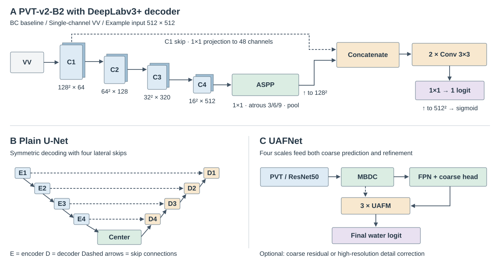

# SAR 水体分割模型结构

当前 BC 基线使用 **PVT-v2-B2 编码器 + DeepLabv3+ 风格解码器**。输入是一幅离线归一化的单 VV 功率影像，网络为每个像元输出一个水体 logit。训练用 BCE，推理时经 sigmoid 得到水体概率。



**图 1**　A 展示当前基线。以 512 × 512 输入为例，PVT 输出四级特征，图中尺寸写作“空间大小 × 通道数”。ASPP 取最深层 C4 提取上下文，上采样后与浅层 C1 拼接；C2、C3 参与编码，解码头直接读取 C1 和 C4。B 展示普通 U-Net 的四条同尺度跳连。C 展示 UAFNet 中粗预测与三级 UAFM 的连接。实际训练窗口由数据配置指定。

## 训练入口支持哪些组合

在 `configs/train.yaml` 的 `model` 下，`ARCHITECTURE` 选择完整分割结构，`BACKBONE` 选择编码器。表中 **B2–B5** 分别写作 `pvt_v2_b2.in1k` 到 `pvt_v2_b5.in1k`，**ResNet50** 写作 `resnet50.tv_in1k`。输出头数与每头通道数分开列出。

| ARCHITECTURE | BACKBONE | 特征如何进入预测 | 输出头 × 每头通道 |
|---|---|---|---|
| `deeplabv3plus` | B2–B5 | C4 → 五支路 ASPP；C1 → 48 通道投影；拼接后经两次 3×3 卷积。默认 B2、ASPP 宽 256、空洞率 3/6/9 | 1 × 1 |
| `semantic_fpn` | B2 或 ResNet50 | 四级特征分别投影至相同通道数，语义头将它们对齐、相加并分类。适合固定解码头比较编码器 | 1 × 2 |
| `unet` | `plain_cnn` | 四次池化、卷积瓶颈、四次转置卷积上采样；每级拼接对应编码器特征 | 1 × 2 |
| `sentinel1_water_unet` | `s1water_cnn` | Wagner 五级编码器与五条跳连，最近邻上采样，每级三层卷积 | 1 × 1 |
| `unetpp` | `s1water_cnn` | 同一 S1 Water 编码器与 1024 通道瓶颈；六尺度嵌套密集跳连，15 个两层卷积节点；只监督最终全分辨率输出 | 1 × 1 |
| `unet` | `mobilenet_v2` | 复用 ai4g 结构对照中的 SMP U-Net，MobileNetV2 提取多尺度特征，解码器逐级上采样。可在统一入口选择，也保留原 DFC 实验脚本 | 1 × 1 |
| `uanet` | B2 | 建筑分割结构的水体标签适配。由 `STAGE` 决定参与训练的模块，见下表 | 1 × 2 或 4 × 2 |
| `uafnet` | B2–B5 或 ResNet50 | 各尺度经 MBDC，FPN 和语义头给出粗预测，三级 UAFM 逐步细化。可切换最终残差、分尺度空洞率、高分辨率修正 | 4 × 1 |
| `uafnet` + `UAFNET_REFINEMENT_DECODER: unetpp` | B2 | 保留 MBDC、FPN 和粗预测，以 U-Net++ 风格的密集跳连替换三级 UAFM；此组合要求关闭高分辨率修正 | 4 × 1 |

| UANet 的 STAGE | 新增计算 | 用于验证的输出 |
|---|---|---|
| `mbdc` | 各尺度特征经多分支空洞卷积后送入语义头 | 粗预测 |
| `fpn` | MBDC 后加入自顶向下的 FPN | 融合后的粗预测 |
| `uafm` | 加入三级不确定性引导细化 | 最终细化头 |
| `full` | 在首次细化前，用 PSM 和 CGM 调整最深层特征 | 最终细化头 |

多头模型训练时监督各输出，验证取最后一头。单通道头支持 BCE 或 BCE+Dice；当前整景重叠融合验证支持 BCE 和 CE。双通道头用 CE，沿用历史配方的 Adam、随机采样。切换架构时也要核对损失、类别权重和输出目录。若希望只测编码器差异，可固定 `semantic_fpn`，在 B2 与 ResNet50 之间切换，沿用同一划分、预处理和训练配方。

## 怎样切换

当前组合在原 YAML 中写为：

```yaml
model:
  ARCHITECTURE: deeplabv3plus
  BACKBONE: pvt_v2_b2.in1k
```

训练本仓库的普通 U-Net 时，在同一份完整 YAML 中修改以下字段。用 S1 双极化样本对照时，另将数据路径指向 DFC 影像和标签，设置 `data.DATA_LAYOUT: patch`、`POLARIZATIONS: [VV, VH]` 和 `POLARIZATION_BANDS: {VV: 1, VH: 2}`；用 BC 数据则保留原单 VV 设置。

```yaml
model:
  ARCHITECTURE: unet
  BACKBONE: plain_cnn
training:
  LOSS_NAME: ce
  CLASS_WEIGHT_MODE: none
  SAMPLING: random
```

新实验使用独立的 `paths.OUTPUT_DIR` 并设 `RESUME_CHECKPOINT: null`。运行 `python src/supervised/train.py configs/train.yaml`。旧 YAML 的 `run.METHOD: pvt` 和 `resnet50` 对应现在的 `semantic_fpn` 加各自编码器；旧 `deeplabv3` 对应 `deeplabv3plus`。旧配置仍可单独运行。

## 与 sentinel1-water-unet 的对应关系

BC 可选择独立的 `sentinel1_water_unet + s1water_cnn`。下表对照普通 U-Net 和作者公开网络。

| | 本仓库普通 U-Net | sentinel1-water-unet 的公开实现 |
|---|---|---|
| 输入 | 按配置读取实际极化；BC 为单 VV，DFC 可用 VV/VH | 10 m S1 VV/VH，σ⁰ dB 映射为 8 位；输入按 VV、VH、VV、VH 排列，再除以 255 |
| 编码 | 4 次池化，默认瓶颈 512 通道 | 5 次池化，池化后 dropout 0.5，瓶颈 1024 通道 |
| 解码 | 转置卷积，拼接后两层卷积 | 最近邻上采样，拼接后三层卷积 |
| 输出 | 两类 logits，训练用 CE | 单通道 sigmoid 水体概率，可裁去边缘后拼景 |

**训练结构对照**　在 168 服务器的仓库根目录运行 `python src/supervised/train.py configs/168/train_s1water_bc.yaml`。该配置与 [PVT 标准配置](../configs/train.yaml) 使用相同的 BC 单 VV 清单、Z-score 输入、窗口、采样、损失和验证设置。对照模型采用 `sentinel1_water_unet + s1water_cnn`，从随机权重开始，实验写入独立目录。[168 服务器配置](../configs/168/train_s1water_bc.yaml)

单 VV 在训练中只占一个通道。网络返回一个 logit，BCE 和验证代码各自在需要的位置处理 sigmoid。该模式随机初始化；若 PVT 使用 ImageNet 初始化，两组对比包含初始化差异。直接试用作者四通道权重是另一项跨传感器实验。BC 的相对功率与原模型的 S1 σ⁰ dB 缩放含义不同。[BC 训练实现](../src/supervised/models/sentinel1_water_unet.py) · [作者实现](https://github.com/fabien-w/sentinel1-water-unet/blob/main/src/s1water/model.py) · [论文](https://doi.org/10.3390/rs16061056)

## S1 Water 编码器的 U-Net++ 分支

`unetpp + s1water_cnn` 使用 32/64/128/256/512/1024 通道的六个尺度。编码器的池化、Dropout 0.5、BN 和最近邻上采样与现有 S1 Water U-Net 一致。解码节点 `X(i,j)` 拼接同尺度的全部前序节点 `X(i,0)…X(i,j−1)`，以及上采样的 `X(i+1,j−1)`；经过两次 Conv–BN–ReLU 后得到该节点输出。最终用 `X(0,5)` 的 1×1 卷积生成水体 logits。[UNet++ 原论文式 (1)](https://arxiv.org/abs/1807.10165)

本轮采用单输出头 BCE，未使用论文的深监督和多头平均。S1 VV＋DEM 对照配置为 [train_s1water_unetpp_trainnorm80.yaml](../configs/s1/train_s1water_unetpp_trainnorm80.yaml)，其训练参数与原 S1 U-Net 配置相同，结果保存到独立目录。新结构需从头训练，原 U-Net 检查点不能续跑为 U-Net++。该分支的模型标识为 `sentinel1_water_unetpp`；既有 `pvt_unetpp_refinement` 标识仍指 PVT/UAFNet 中的嵌套细化模块。

## 代码索引

- [统一模型选择与训练](../src/supervised/train.py) · [训练 YAML](../configs/train.yaml) · [按检查点重建网络](../src/supervised/models/checkpoint.py)
- [PVT、ASPP、MBDC、PSM、CGM、UAFM 和嵌套解码](../src/supervised/models/pvt.py) · [ResNet50](../src/supervised/models/resnet.py) · [共享 FPN 与语义头](../src/supervised/models/common.py)
- [普通 U-Net](../src/supervised/models/unet.py) · [MobileNetV2 U-Net 实验](../src/supervised/experimental/experimental_model_unet_mobilenet.py) · [U-Net 推导](unet_functions_and_derivations.md) · [PVT-UANet 推导](pvt_uanet_functions_and_derivations.md)
- [S1 Water 编码器＋U-Net++](../src/supervised/models/unetpp.py) · [S1 U-Net++ 对照配置](../configs/s1/train_s1water_unetpp_trainnorm80.yaml)
