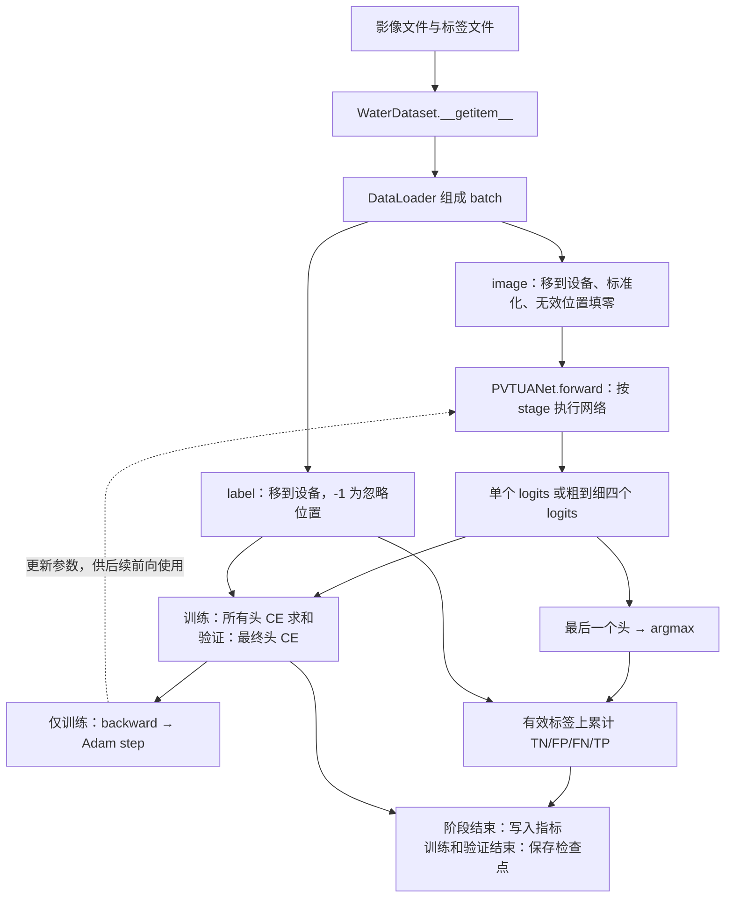
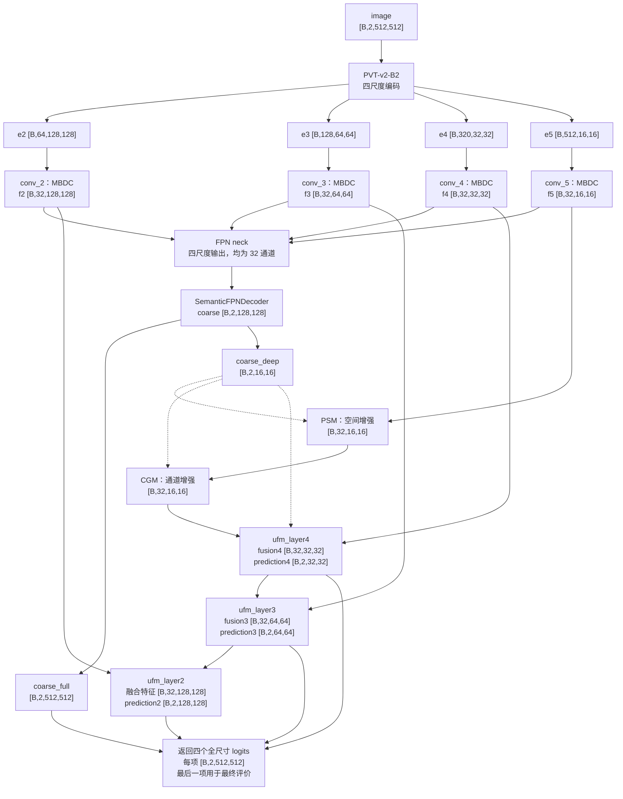
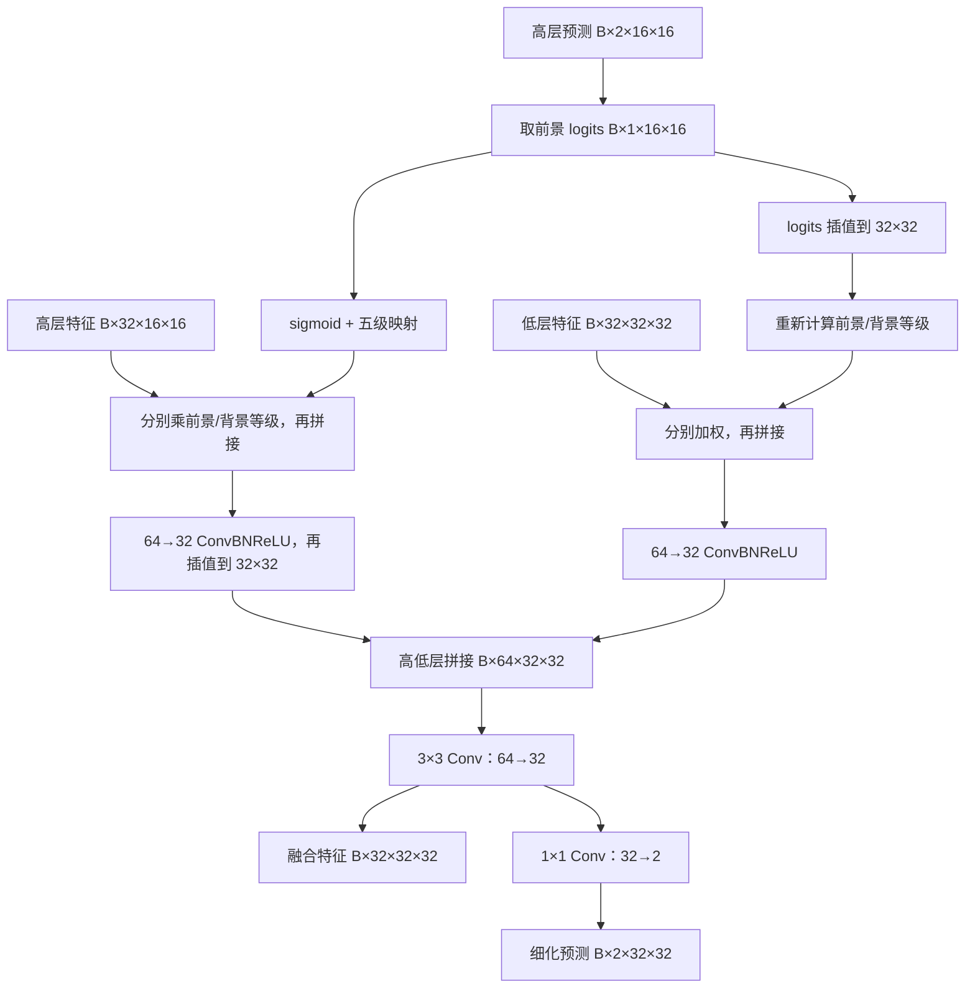
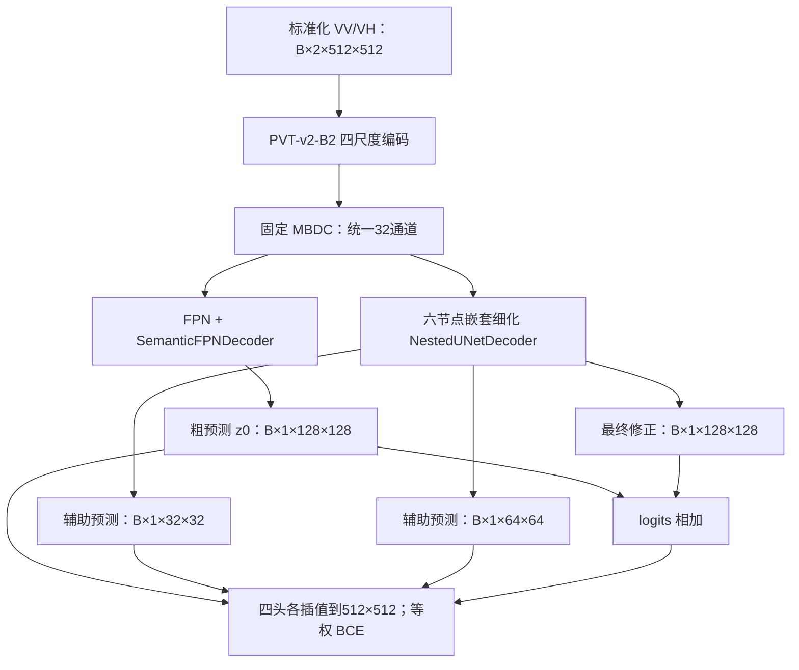

# PVT-UANet 函数含义与计算推导

本文沿用 [U-Net 函数含义与计算推导](unet_functions_and_derivations.md) 的写法，结合当前源码解释实现路径、类与函数、张量尺寸和关键计算。

主要对应 [网络模块](../src/models/pvt.py)、[共享语义解码头](../src/models/common.py)、[训练入口](../src/train.py)、[公共训练器](../src/train.py) 和 [检查点加载器](../src/models/checkpoint.py)。阶段实验概览见 [UANet 分阶段说明](stages/uanet_stages.md)。

网络已按骨干收拢：PVT 及其特有模块集中在 `models/pvt.py`，共用卷积、FPN 和语义解码头集中在 `models/common.py`。查找具体类与方法时可先看 [模型结构与函数索引](model_structure.md)。

统一示例为输入 `[B,2,512,512]`、两个输出类别、解码通道数 32。`B` 表示批次大小；两个输入通道按数据文件波段编号选取，本文不由网络结构推断其极化顺序或物理单位。

**阅读时先区分：模型类默认 `stage="full"`，统一训练入口默认 `METHOD="uanet"`，并显式传入 `STAGE="mbdc"`。** 下文用 full 讲清完整计算，再说明各阶段删去了哪些路径。

初次阅读建议先看第 2 章的完整调用与数据流，再看第 3～4 章的阶段和网络图；第 5～18 章展开模块细节，第 19～20 章补充损失、保存与校准。

## 1. 当前模型和原 U-Net 的关系

原 U-Net 用卷积编码器提取特征，再通过逐级上采样和跳跃连接恢复预测。当前 PVT-UANet 是独立的完整分割网络：PVT 骨干提取四尺度特征，后面的卷积、先验增强和不确定性融合模块承担解码工作。

```text
原 U-Net：SAR → 卷积编码器 → 跳跃连接/卷积解码器 → 分类 logits

PVT-UANet：SAR → PVT → MBDC → FPN/粗预测 → 先验增强/不确定性融合 → 分类 logits
```

PVT-UANet 没有调用原 `UNet`，也不是把 Transformer 串接到原 U-Net 后面。其骨干使用 Transformer，解码部分仍大量使用卷积与插值，是混合结构。

当前代码的 `full` 对照作者公开建筑 PVT-UANet 的活动计算路径，并适配两个 SAR 输入通道。SAR 比赛 UAFNet 的论文图没有 PSM/CGM，而且使用 VH/VV/VH 三通道与多模型集成；不能把两者的实验配置全部等同。

## 2. 文件职责与执行入口

| 文件 | 主要对象 | 职责 |
|---|---|---|
| `src/train.py` | `main`、`create_trainer` | METHOD 同级选择方法，顶部设置阶段与训练参数 |
| `src/train.py` | `WaterSegmentationTrainer` | 数据划分、标准化、训练、验证、保存 |
| `src/models/pvt.py` | `PVTUANet` | 组合网络层并执行完整前向计算 |
| `src/models/pvt.py` | `MBDC`、`PSM`、`CGM`、`UncertaintyRank`、`UAFM` | 同文件内的特征处理类 |
| `src/models/common.py` | `BasicConv2d`、`DoubleConv` | 公共卷积与双卷积 |
| `src/models/pvt.py` | `build_pvt_backbone` | 创建四尺度 PVT 骨干 |
| `src/models/common.py` | `FPN` | 自顶向下特征融合 |
| `src/models/common.py` | `SemanticFPNDecoder` | 四尺度粗预测解码头 |
| `src/models/checkpoint.py` | `load_model` | 按模型名和阶段重建已训练模型 |
| `src/calibrate_bn.py` | `BNCalibrator` | 可选的训练后 BN 统计量校准 |

从项目根目录执行：

```powershell
conda activate sar-water
python src/train.py
```

当前统一入口设置 `METHOD="uanet"`、`STAGE="mbdc"`。四种方法是同级选择，具体模块按 stage 启用。

### 2.1 入口、训练器和模型的关系

| 层次 | 对象 | 职责 |
|---|---|---|
| 训练入口 | `train.py` 的 `main()`、`create_trainer()` | 读取顶部变量，选择方法和实验目录 |
| 公共训练器 | `train.py` 的 `WaterSegmentationTrainer` | 数据准备、标准化、训练、评价和保存 |
| 分割网络 | `models/pvt.py` 的 `PVTUANet` | 将输入影像变为水体分类分数 |

入口不再定义模型专用训练器子类。`create_trainer()` 直接创建一个 `WaterSegmentationTrainer`，训练器通过 `self.model` 持有网络实例。

```python
def main():
    trainer = create_trainer()
    trainer.train()
```

创建模型只在初始化时执行一次，每个批次重复执行 forward。

### 2.2 `create_trainer()`：四种同级方法的选择

源码：[统一训练入口](../src/train.py)。顶部参数：

```python
METHOD = "uanet"  # unet、pvt、resnet50、uanet
STAGE = "mbdc"    # 只对 uanet 生效
```

`create_trainer()` 通过直接的 if/elif 选择：

| METHOD | model_class | 实验目录名 |
|---|---|---|
| `unet` | `UNet` | `unet_baseline` |
| `pvt` | `PVTWaterNet` | `pvt_baseline` |
| `resnet50` | `ResNet50WaterNet` | `resnet50_baseline` |
| `uanet` | `PVTUANet` | `pvt_uanet_阶段` |

选好后直接调用 `WaterSegmentationTrainer(model_class=..., model_kwargs=..., model_info=..., ...)`。

- `model_class` 是模型类，还不是网络实例。
- `model_kwargs` 真正决定网络构造参数；只有 uanet 分支包含 stage。
- `model_info` 记录检查点元信息，uanet 仍保存为 `model_name="pvt_uanet"`，以兼容旧权重。
- `OUTPUT_DIR=None` 时在函数内按当前 METHOD/STAGE 选择目录，显式指定时使用自定义路径。

选择其他方法前必须修改 METHOD；仅修改 STAGE 不会把 pvt 基线变成 UANet。

### 2.3 `WaterSegmentationTrainer.__init__()`：一次性准备训练对象

源码：[公共训练器](../src/train.py)。

```text
main() → create_trainer()
  └─ WaterSegmentationTrainer(...)
       ├─ 保存参数，设置随机种子、设备和 AMP
       ├─ WaterDataset：建立文件列表和标签配对
       ├─ random_split：训练/验证 Subset
       ├─ DataLoader：批次迭代器
       ├─ calculate_normalization：训练子集逐通道统计
       ├─ model_class(**model_kwargs)：创建网络并移到设备
       ├─ CrossEntropyLoss、Adam、GradScaler
       └─ 实验目录、metrics.csv 和划分列表
```

`self.model = model_class(**self.model_kwargs).to(self.device)` 在当前配置下创建 `PVTUANet(in_channels=2, num_classes=2, decoder_channels=32, pretrained=True, stage="mbdc")`。

训练器成员 `dataset/train_set/val_set` 管理样本，`train_loader/val_loader` 管理批次，`mean/std` 保存输入统计，`model/criterion/optimizer/scaler` 管理模型训练，`run_dir` 保存本次结果。没有父类或模型专用子类参与额外分派。

### 2.4 `WaterDataset` → `DataLoader`：文件怎样变成批次

源码：[数据读取模块](../src/datasets/water_dataset.py)。

`WaterDataset.__init__()` 建立路径列表，没有一次性加载全部影像。访问某个样本时，`__getitem__(index)` 才读取文件：

```text
影像路径
  → rasterio 按 BANDS 读取指定波段
  → 根据文件掩膜和 NaN/Inf 得到 valid_mask
  → 无效影像位置填零
  → 按相对路径和同名规则查找标签
  → 无效影像/标签位置的内部标签设为 -1
  → 返回 image、label、valid_mask、name
```

数据集保留有效位置的原始标签编码；0=非水体、1=水体是当前训练使用的类别约定，不是读取器根据影像推断出来的。

以 512×512 影像为例：

| 字段 | 单张样本 | DataLoader 组成批次后 | 用途 |
|---|---|---|---|
| `image` | `[2,512,512]`，float32 | `[B,2,512,512]` | 网络输入 |
| `label` | `[512,512]`，int64 | `[B,512,512]` | 损失与指标 |
| `valid_mask` | `[512,512]`，bool | `[B,512,512]` | 输入有效性处理 |
| `name` | 相对文件名 | 一批文件名 | 记录和定位样本 |

当前 batch size 为 2，最后一批可以少于两张。训练 DataLoader 打乱顺序，验证 DataLoader 保持顺序。`Subset` 只记录样本索引，不复制影像文件。

`calculate_normalization()` 在训练前遍历一次训练子集，累计所选波段共同有效位置的逐通道统计量。验证样本不参与；统计时不按水体/非水体类别筛选像素。

### 2.5 `train()` → `run_epoch()`：每个批次进入模型之前

初始化结束后执行本类的 `WaterSegmentationTrainer.train()`：

```text
每一轮 epoch
  ├─ run_epoch(epoch, "train", train_loader)
  ├─ run_epoch(epoch, "val", val_loader)
  └─ save_checkpoint(epoch)
```

`run_epoch()` 取出一个批次后，依次执行：

```python
image = batch["image"].to(self.device)
label = batch["label"].to(self.device)
image = (image - self.mean) / self.std
image = image.masked_fill(
    ~batch["valid_mask"].to(self.device).unsqueeze(1), 0
)
outputs = self.model(image)
```

因此数据流是：

```text
CPU 上的原始存储值张量
  → 移到训练设备
  → 使用训练统计量逐通道标准化
  → 无效输入位置重新填零
  → PVTUANet.forward(image)
```

**只有 `image` 进入模型。** `label` 留在训练器中计算损失和指标，`valid_mask` 用于无效输入处理，不作为额外通道送进 PVT。

注意两个同名方法：`trainer.train()` 是整个训练循环；`trainer.model.train(True/False)` 是 PyTorch 网络的模式切换，控制 BN、DropPath 等行为。网络模式切换本身不决定是否记录梯度，后者由 `torch.set_grad_enabled(training)` 控制。

### 2.6 `PVTUANet.__init__()`：功能模块怎样组成网络

源码：[完整网络](../src/models/pvt.py)。

```text
PVTUANet
├─ backbone       ← pvt.py：build_pvt_backbone()
├─ conv_2～conv_5  ← pvt.py：四个 MBDC
│                    └─ common.py：BasicConv2d
├─ neck           ← common.py：FPN，非 mbdc 阶段创建
├─ decoder        ← common.py：SemanticFPNDecoder
├─ psm / cgm      ← pvt.py：仅 full 创建
└─ ufm_layer4/3/2 ← pvt.py：uafm、full 创建
                     ├─ pvt.py：UncertaintyRank
                     └─ common.py：BasicConv2d
```

`build_pvt_backbone()` 调用 timm 创建骨干，返回的网络注册为 `self.backbone`。每个批次执行的是 `self.backbone(image)`，不会每次调用构造函数重新下载或创建骨干。

`self.model(image)` 通过 PyTorch 模块调用机制进入 `PVTUANet.forward()`；forward 再依次调用各子模块。初始化时已经注册的层在不同批次间复用同一组参数。

### 2.7 一次前向的数据流：当前阶段与完整阶段

各阶段先共享 PVT 和 MBDC 路径：

| 变量 | PVT 输出 | MBDC 输出 |
|---|---|---|
| `e2 → f2` | `[B,64,128,128]` | `[B,32,128,128]` |
| `e3 → f3` | `[B,128,64,64]` | `[B,32,64,64]` |
| `e4 → f4` | `[B,320,32,32]` | `[B,32,32,32]` |
| `e5 → f5` | `[B,512,16,16]` | `[B,32,16,16]` |

当前 `mbdc` 阶段直接把四个 MBDC 输出交给语义解码头，得到 `[B,2,128,128]` 粗预测，再插值为 `[B,2,512,512]` 返回。没有执行 FPN、PSM、CGM 和 UAFM。

`full` 阶段则执行：

```text
四个 MBDC 输出
  ├─ FPN → SemanticFPNDecoder → coarse [B,2,128,128]
  │                              ├─ 插值到512：coarse_full
  │                              └─ 缩到16：coarse_deep
  └─ 保留 f2/f3/f4/f5
       ├─ f5 + coarse_deep → PSM → CGM：增强的16尺度特征
       ├─ f4 + 增强特征 + coarse_deep → UAFM4：32尺度特征和预测
       ├─ f3 + 上级融合特征及预测     → UAFM3：64尺度特征和预测
       └─ f2 + 上级融合特征及预测     → UAFM2：128尺度特征和预测
```

**FPN 输出用于粗预测；UAFM 的低层输入来自 MBDC。** 三级融合不仅传递特征，也把新预测传给下一级，作为新的不确定性引导。各层的计算细节分别见第 10～18 章。

返回训练器之前，三个细化预测都插值到输入大小：

```python
outputs = (coarse_full, prediction4_full, prediction3_full, prediction2_full)
```

每项均为 `[B,2,512,512]` logits，最后一项用于最终评价。`uafm` 阶段的流向与此相似，但不执行 PSM/CGM，直接将 MBDC 的 `f5` 输入第一级 UAFM。

### 2.8 回到训练器：损失、梯度和评价

模型 forward 返回后，继续执行的是同一个 `run_epoch()`：

```python
predictions = outputs if isinstance(outputs, (tuple, list)) else (outputs,)
logits = predictions[-1]
```

单输出包装成一个元素的元组，多输出保留原顺序，从而共用训练代码：

| 阶段 | 训练损失 | 验证损失 | 指标来源 |
|---|---|---|---|
| `mbdc / fpn` | 一个 CE | 一个 CE | 唯一预测 |
| `uafm / full` | 四个 CE 等权求和 | 最后一个头的 CE | 最后一个预测 |

标签在此处才与网络输出汇合。交叉熵直接使用 logits，忽略标签 -1，不需要提前计算 softmax。

训练分支继续执行：

```python
self.scaler.scale(loss).backward()
self.scaler.step(self.optimizer)
self.scaler.update()
```

梯度通过计算图回传，Adam 更新骨干与各解码模块的参数。损失和更新由训练器管理，模型类只组织前向计算。离散等级图经过 detach，不会通过等级映射向其输入 logits 回传梯度；特征及其他连续路径仍按计算图求导。

随后用最后一个头计算 `logits.detach().argmax(dim=1)`，产生 `[B,512,512]` 类别图，在有效标签像素上累计混淆矩阵。F1、IoU 等是整个阶段累计计数后的结果，不是逐批 F1 的直接平均。

验证复用相同数据准备与前向路径，但网络切换为 eval、关闭梯度记录，不执行优化器更新。

下图概括一个批次的闭环；验证时不执行反向传播和更新权重：



### 2.9 每轮保存，以及训练之外的重载与校准

`train()` 等到训练、验证两个 `run_epoch()` 都完成后，调用 `save_checkpoint(epoch)`：

```text
outputs/pvt_uanet_阶段/本次时间戳/
  ├─ metrics.csv       每个训练/验证阶段追加一行
  ├─ last.pth          最近完成验证的一轮
  ├─ best.pth          最低验证 loss 对应模型
  └─ abnormal.pth      满足异常条件时保留最近快照
```

检查点同时保存模型构造参数、网络参数与缓冲区、标准化统计量、训练/验证文件列表等；没有保存完整优化器状态，不能等同于完整断点续训。

[checkpoint.py](../src/models/checkpoint.py) 的 `load_model()` 不参与当前入口从头初始化网络的路径。后续评价、推理或 BN 校准时，才按下面的顺序重载：

```text
读取检查点
  → model_name='pvt_uanet'
  → 读取 model_kwargs，包含 stage
  → pretrained=False，创建相同 PVTUANet 结构
  → 严格加载 state_dict
  → 返回模型供调用者使用
```

[calibrate_bn.py](../scripts/calibrate_bn.py) 则是独立的可选入口：加载目标检查点，用训练影像重新统计 BN 的运行均值与方差，比较校准前后的验证结果并另存模型。`train.py` 不会自动调用它。具体参数选择和 BN/LN 的区别见第 20 章。

对照源码时，可沿以下顺序阅读一次完整流程：

```text
train.py：main() → create_trainer()
  → WaterSegmentationTrainer.__init__()
  → WaterDataset.__getitem__()：统计阶段和批次读取时按需调用
  → WaterSegmentationTrainer.train()
  → WaterSegmentationTrainer.run_epoch()
  → PVTUANet.forward() → 各功能模块的 forward()
  → 返回 run_epoch()：损失、反向传播、指标
  → WaterSegmentationTrainer.save_checkpoint()
```

## 3. 四个阶段实际启用了什么

| `STAGE` | 数据流 | 返回类型 | 预测数量 |
|---|---|---|---:|
| `mbdc` | PVT → MBDC → 语义解码头 | Tensor | 1 |
| `fpn` | PVT → MBDC → FPN → 语义解码头 | Tensor | 1 |
| `uafm` | 上述粗预测 → 三级 UAFM | tuple | 4 |
| `full` | 最深层增加 PSM → CGM，再进行三级 UAFM | tuple | 4 |

不同阶段分别写入 `outputs/pvt_uanet_阶段/时间戳/`。阶段之间没有自动接着训练；当前都是加载 ImageNet 骨干、随机初始化新增模块，分别开始一次实验。原简单 PVT 基线通过 `METHOD="pvt"` 选择 `PVTWaterNet`。

`STAGE` 影响实际建立哪些层，例如：

```python
if stage != "mbdc":
    self.neck = FPN(channels)

if stage == "full":
    self.psm = PSM()
    self.cgm = CGM()
```

这不是把未使用模块的结果丢弃，而是在对应阶段不建立这些模块。

## 4. 完整网络流程图与尺寸

下图仅表示 `stage="full"`。粗预测路径与细化路径共享 MBDC 特征，但输入位置不同。



两处容易误读：

1. `coarse` 的原生空间尺寸是 128×128，随后另行缩小成 `coarse_deep` 以引导 16×16 的深层特征；不是直接在 16×16 上产生粗预测。
2. UAFM 的浅层输入是 `f4/f3/f2`，即 **MBDC 特征**；FPN 输出用于粗预测，不是直接替代这些浅层输入。

源码变量从 `e2/f2` 命名到 `e5/f5`，沿用作者编号；实际仍只有四个尺度，没有遗漏一个 `e1` 输入层。

## 5. `__init__()`、`forward()` 与模块管理

```python
class PVTUANet(nn.Module):
    def __init__(self, ...):
        super().__init__()
        self.backbone = ...
        self.conv_2 = ...
```

`super().__init__()` 初始化 PyTorch 对子模块、参数、缓冲区和运行状态的管理。随后把卷积等对象赋给 `self.xxx`，才会被模型正确注册。

- `__init__()`：创建层与参数，只在构造模型时执行。
- `forward(image)`：规定影像如何经过已创建的模块，每个批次调用一次。
- `model(image)`：通过 PyTorch 模块调用机制执行 forward，同时处理钩子。

当前 `BasicConv2d`、`MBDC` 等类均继承 `nn.Module`，各自实现 forward；内部的一些串行支路使用 `nn.Sequential`。

### 5.1 `nn.Sequential`

```python
self.branch1 = nn.Sequential(
    BasicConv2d(...),
    BasicConv2d(...),
    ...,
)
```

它自动按顺序执行支路中的各层，适合无分叉的局部路径。

### 5.2 `nn.ModuleList`

```python
self.lateral_convs = nn.ModuleList([...])
```

它是被 PyTorch 注册的模块容器，**本身不规定如何依次执行**。FPN 的 forward 用循环明确处理每一个尺度。普通 Python list 虽然能存对象，却不会以同样方式注册其中的子模块。

## 6. `timm.create_model()`：创建 PVT 骨干

完整模型调用 `self.backbone = build_pvt_backbone(in_channels, pretrained)`。该公共函数位于 `models/pvt.py`，内部调用：

```python
return timm.create_model(
    "pvt_v2_b2.in1k", pretrained=pretrained, in_chans=in_channels,
    features_only=True, out_indices=(0, 1, 2, 3), drop_path_rate=0.1,
)
```

| 参数 | 当前含义 |
|---|---|
| `pvt_v2_b2.in1k` | PVT-v2-B2 的 ImageNet 预训练配置，非 B2-Li |
| `pretrained=True` | 初始化时加载骨干预训练权重 |
| `in_chans=2` | 接收当前两个输入通道 |
| `features_only=True` | 返回空间特征，不使用 ImageNet 整图分类头 |
| `out_indices=(0,1,2,3)` | 取四级编码输出 |
| `drop_path_rate=0.1` | 按层分配随机深度概率，最大值为 0.1 |

预训练不会冻结骨干；当前优化器接收全部 `model.parameters()`，PVT 与新模块都参与学习。

RGB 权重适配两个输入通道时，当前 timm 使用首卷积 RGB 权重的前两个通道并乘 `3/2`。这只是权重初始化策略，不表示 RGB 通道和两个 SAR 极化在物理上对应。输入仍使用当前训练集的均值/标准差，不套用 ImageNet 输入标准化。

## 7. PVT 怎样把图像变成四尺度特征

### 7.1 Overlapping Patch Embedding

首级使用 `7×7` 卷积、stride=4、padding=3，将两个影像通道映射为 64 个特征通道。

普通卷积尺寸公式为：

$$
H_{out}=\left\lfloor\frac{H_{in}+2p-d(k-1)-1}{s}\right\rfloor+1.
$$

代入 512、k=7、p=3、s=4、d=1：

$$
H_{out}=\left\lfloor\frac{512+6-6-1}{4}\right\rfloor+1=128.
$$

因此 `[B,2,512,512] → [B,64,128,128]`。因为卷积核 7 大于步长 4，相邻 patch 有重叠，不是把图像切成互不重叠的 7×7 块。

后三级分别使用 `3×3`、stride=2、padding=1 的重叠嵌入，空间尺寸为 64、32、16。对于奇数尺寸，不能简单用整数除法截断；应按卷积公式计算，本结构通常相当于向上取整。

### 7.2 特征图与 token 序列

第一尺度可在概念上写成：

```text
[B,64,128,128]
      ↓ 展开空间位置，调整维度
[B,16384,64]
```

`N=128×128=16384`，每个空间位置对应一个 64 维 token。Transformer 处理后再按原空间顺序恢复二维特征。timm 内部还使用通道末尾的布局，不能假设每一行库代码都固定采用 `[B,N,C]`；对当前模型暴露的四个输出统一为 `[B,C,H,W]`。

PVT-v2 不需要这里额外添加一个 CLS token，也没有沿用先前概念示意图中固定的 ViT 位置编码步骤；卷积嵌入和带深度卷积的前馈网络引入了空间局部性。

### 7.3 B2 的四级配置

| 输出变量 | 输出尺寸 | Block 数 | 注意力头数 | MLP 扩张倍率 | 空间缩减率 |
|---|---|---:|---:|---:|---:|
| `e2` | `[B,64,128,128]` | 3 | 1 | 8 | 8 |
| `e3` | `[B,128,64,64]` | 4 | 2 | 8 | 4 |
| `e4` | `[B,320,32,32]` | 6 | 5 | 4 | 2 |
| `e5` | `[B,512,16,16]` | 3 | 8 | 4 | 1 |

每个头的维度均为 64，例如第三尺度 `320/5=64`。这里的特征通道是模型学习的表示，不是额外观测到的 SAR 波段。

## 8. PVT Block：注意力、LayerNorm 与卷积前馈

每个 Block 主要包括：

$$
X_1=X+\operatorname{DropPath}(\operatorname{Attention}(\operatorname{LN}(X))),
$$

$$
Y=X_1+\operatorname{DropPath}(\operatorname{MLP}(\operatorname{LN}(X_1))).
$$

这里的残差连接做逐元素相加，保持该级尺寸。LayerNorm 沿每个 token 的特征维归一化，不使用 BatchNorm 的跨批次运行均值、方差。

### 8.1 空间缩减注意力

PVT 保留全部位置的 Q，同时缩减 K/V 的空间位置。第一尺度的形状为：

```text
Q：从 128×128 的位置产生 → [B,1,16384,64]
K/V：先通过 stride=8 的空间缩减 → 16×16
                                    → [B,1,256,64]
注意力关联                         → [B,1,16384,256]
汇总 V 后恢复                       → [B,16384,64]
```

单个注意力头的计算为：

$$
A=\operatorname{softmax}\left(\frac{QK^T}{\sqrt{d_k}}\right),\qquad O=AV.
$$

对 512 输入，后三级 K/V 的位置数也都是 256：64/4=16、32/2=16，最后一级本来就是 16×16。各级 Q 的位置数仍分别为 16384、4096、1024、256。

这减少了相较全分辨率自注意力的关联数量，但不能把当前 B2 误称为 B2-Li。timm 可用融合注意力算子计算，实际不一定显式保存整个关联矩阵。

### 8.2 带深度卷积的 MLP

与纯逐 token 的两层 Linear 相比，PVT-v2 的前馈路径包含二维深度卷积：

```text
Linear：C → C×扩张倍率
恢复二维排列 → 3×3 Depthwise Conv
GELU → 恢复 token 排列 → Linear：隐藏维 → C
```

第一尺度隐藏通道为 `64×8=512`。深度卷积设置 `groups=隐藏通道数`，各通道独立处理空间邻域；它与把所有通道混合的普通卷积不同。

DropPath 在训练时随机跳过残差分支，eval 时不再随机丢弃。它与学习率、普通 Dropout、或者整个网络停止训练都不是同一个概念。

## 9. `BasicConv2d`：卷积、BN、ReLU

```python
self.conv = nn.Conv2d(in_channels, out_channels, kernel_size,
                      padding=padding, dilation=dilation, bias=False)
self.bn = nn.BatchNorm2d(out_channels)
self.relu = nn.ReLU(inplace=True)
```

forward 为 `relu(bn(conv(feature)))`。

- 卷积提取局部特征、改变通道数。
- BN 调整中间特征分布，保留张量尺寸。
- ReLU 引入非线性，负值置零。
- `bias=False` 去掉卷积偏置，BN 仍有可学习平移参数。

训练时 BN 按通道统计批次与空间位置；eval 使用保存的运行统计量。它与原始 SAR 的输入标准化、PVT 中的 LayerNorm 是三个不同位置的操作。

## 10. `MBDC`：三分支空洞卷积

MBDC 是 Multi-Branch Dilation Convolution 的多分支特征增强模块。以 `self.conv_2` 为例，输入 `[B,64,128,128]`，输出 `[B,32,128,128]`。

### 10.1 三个分支

| 支路 | 层次 | 输出尺寸 |
|---|---|---|
| `branch0` | 1×1，64→32 | `[B,32,128,128]` |
| `branch1` | 1×1，再连续 d=4、8、16 的 3×3 | `[B,32,128,128]` |
| `branch2` | 1×1，再连续 d=2、4、8 的 3×3 | `[B,32,128,128]` |

这里是**每个分支内部连续执行三层不同空洞率卷积**，不是把六个空洞卷积全部并行作用于原输入。

### 10.2 空洞卷积如何保持尺寸

3×3 卷积的有效覆盖宽度为：

$$
k_{eff}=d(k-1)+1=2d+1.
$$

例如 d=4 时覆盖 9×9 的位置范围，但实际仍只有 3×3 个卷积权重，间隔位置没有新增权重。

当前 stride=1、padding=d，因此：

$$
H_{out}=H+2d-d(3-1)=H.
$$

d=16 的 3×3 卷积有效覆盖为 33×33，但高宽保持不变。在最深层只有 16×16 时，会大量接触边界补零，不能简单理解为实际观察到了完整的 33×33 有效场景。

### 10.3 拼接与残差

```text
三个 [B,32,H,W]
      ↓ torch.cat(..., dim=1)
[B,96,H,W]
      ↓ conv_cat：3×3，96→32
[B,32,H,W]
      ↓ 与 conv_res(feature) 相加，再 ReLU
[B,32,H,W]
```

对应：

$$
F=\operatorname{ReLU}\left(\operatorname{ConvBNReLU}_{3\times3}
([B_0(X),B_1(X),B_2(X)])+\operatorname{ConvBNReLU}_{1\times1}(X)\right).
$$

这里的 `B_0/B_1/B_2` 表示支路，不是批次维 B。残差路径通过 1×1 卷积把输入通道投影到 32，所以不是未经变换地直接把 64 通道输入相加。

只按卷积层估计，d=4/8/16 连续支路在该特征网格上的名义感受野为 `1+2×4+2×8+2×16=57`；后接 conv_cat 再增加 2。PVT 特征本身已包含注意力信息，因此这个数字不等于整个网络的实际地面感受野。

四个 MBDC 的结果统一为：

```text
f2：[B,32,128,128]
f3：[B,32, 64, 64]
f4：[B,32, 32, 32]
f5：[B,32, 16, 16]
```

## 11. `FPN.forward()`：自顶向下融合

FPN 是 Feature Pyramid Network，当前作为 neck 连接 MBDC 与粗预测解码头。

```python
laterals = [conv(feature) for conv, feature in zip(self.lateral_convs, features)]
```

`zip` 把四个独立卷积和四层特征一一配对。每个 1×1 侧向卷积为 32→32，通道和空间尺寸不变，但会学习新的通道组合，不是直接复制输入。

### 11.1 逐级相加

若把四个侧向输出记为 `L2/L3/L4/L5`，则：

$$
T_5=L_5,\quad T_4=L_4+\operatorname{Up}(T_5),
$$

$$
T_3=L_3+\operatorname{Up}(T_4),\quad
T_2=L_2+\operatorname{Up}(T_3).
$$

每次 Up 用最近邻插值对齐低层的目标尺寸。这里高层信息会继续向更浅层传递，不是每一级都只加最初独立的相邻特征。

最后各层再经过自己的 3×3 卷积得到四个输出。FPN 使用的普通 Conv2d 包含默认偏置，当前没有额外添加 BN/ReLU。

### 11.2 相加与拼接的区别

FPN 的 `[B,32,H,W] + [B,32,H,W]` 仍为 32 通道；后文 UAFM 的 `cat` 会把两个 32 通道特征拼成 64 通道。二者不能互换。

## 12. `SemanticFPNDecoder`：得到粗预测

这个类和 FPN neck 是两个独立模块。neck 负责跨尺度自顶向下相加；decoder 负责把四个尺度各自转换到 128×128，再相加分类。

### 12.1 `max(1, level)` 与支路长度

```python
for level in range(4):
    for _ in range(max(1, level)):
        ...
```

得到卷积次数 `[1,1,2,3]`。每个卷积后接 BN 和 ReLU；只要 level>0，每个卷积后还上采样 2 倍。

| 输入尺度 | 支路计算 | 最终尺寸 |
|---|---|---|
| 128×128 | ConvBNReLU | `[B,32,128,128]` |
| 64×64 | ConvBNReLU → Up2 | `[B,32,128,128]` |
| 32×32 | ConvBNReLU → Up2 → ConvBNReLU → Up2 | `[B,32,128,128]` |
| 16×16 | 三次 ConvBNReLU → Up2 | `[B,32,128,128]` |

高分辨率支路不是零层；即使不需要上采样，也至少执行一次卷积。

### 12.2 分类分数

四支路通过显式尺寸对齐后相加：

$$
D=D_2+\operatorname{Resize}(D_3)+\operatorname{Resize}(D_4)+\operatorname{Resize}(D_5).
$$

随后：

```python
self.cls_seg = nn.Conv2d(channels, num_classes, 1)
```

将 `[B,32,128,128]` 变为 `[B,2,128,128]` 的 `coarse` logits。1×1 分类卷积为每个像素把 32 个特征组合成两个类别分数，不改变空间大小。

`mbdc` 阶段直接将 MBDC 的四个输出送入该解码头；其他阶段先经过 FPN neck。

## 13. `F.interpolate()`：改变空间大小

```python
coarse_full = F.interpolate(coarse, size=size, mode="bilinear", align_corners=True)
coarse_deep = F.interpolate(coarse, size=f5.shape[-2:], mode="bilinear", align_corners=True)
```

同一张粗预测有两种用途：

| 变量 | 尺寸 | 用途 |
|---|---|---|
| `coarse` | `[B,2,128,128]` | 解码头原生输出 |
| `coarse_full` | `[B,2,512,512]` | 与原图标签对齐，用于监督或单头评价 |
| `coarse_deep` | `[B,2,16,16]` | 与最深层特征对齐，引导 PSM、CGM 和第一级 UAFM |

`size=image.shape[-2:]` 读取输入的高、宽；`size=f5.shape[-2:]` 则读取最深层特征的高、宽。插值改变 H、W，不改变 B 和通道数，也没有可训练参数。这里的 128→16 是缩小，并非所有 `interpolate` 调用都在上采样。

`bilinear` 用邻近四个位置加权计算新值；`nearest` 取最近位置。当前实现有意保留各处的设置：FPN neck 使用 nearest，共享语义解码头使用 bilinear 且 `align_corners=False`，主网络和 UAFM 使用 bilinear 且 `align_corners=True`。后者对齐输入、输出角点的像素中心；前者采用另一套像素坐标映射。它们在边界和中间采样位置上可能产生不同数值。

这些插值与原 U-Net 的 `ConvTranspose2d` 不同：转置卷积通过可学习卷积核进行空间扩展，还可以改变通道数；此处空间变换交给插值，通道变换交给前后的普通卷积。

## 14. `PSM`：粗预测引导的空间增强

PSM 在本实现中承担预测先验引导的空间增强。它接收最深层特征和同尺寸粗预测：

```text
feature：[B,32,16,16]
logits ：[B, 2,16,16]
输出   ：[B,32,16,16]
```

### 14.1 选取前景通道并展平

```python
foreground = logits[:, 1:2]
key = foreground.reshape(batch, 1, height * width)
```

`[:,1:2]` 保留通道维，因此结果是 `[B,1,16,16]`；如果写成 `[:,1]`，就会少掉这一维。

设 N=16×16=256。展平后，`key` 为 `[B,1,256]`。这里直接使用第 1 类的原始 logits，没有先做 sigmoid 或 softmax。

### 14.2 每个特征通道单独计算空间关联

```python
value = feature[:, channel:channel + 1].reshape(batch, 1, height * width)
attention = self.softmax(torch.bmm(value.transpose(1, 2), key))
output = torch.bmm(value, attention.transpose(1, 2))
```

`torch.bmm()` 是逐批次矩阵乘法：`[B,m,k] × [B,k,n] → [B,m,n]`，批次之间互不混合。对当前通道，尺寸推导为：

```text
value                         [B,1,256]
value.transpose(1,2)           [B,256,1]
key                           [B,1,256]
第一次 bmm                     [B,256,256]
沿最后一维 softmax              [B,256,256]
第二次 bmm：1×256 乘 256×256    [B,1,256]
reshape                       [B,1,16,16]
```

忽略批次下标，用 vᶜᵢ 表示通道 c、位置 i 的特征，用 sⱼ 表示位置 j 的前景 logits：

$$
A^c_{ij}=\frac{\exp(v^c_i s_j)}{\sum_{k=1}^{N}\exp(v^c_i s_k)},\qquad
o^c_i=\sum_{j=1}^{N}A^c_{ij}v^c_j.
$$

每一行 Aᶜᵢ,: 的和为 1，表示位置 i 对各空间位置的加权关系。最后将 32 个通道的输出沿通道维拼回：

$$
F_{\mathrm{PSM}}=F+\gamma_p\operatorname{Concat}(o^1,\ldots,o^{32}).
$$

PSM 的注意力是每个通道各自建立的空间矩阵。它没有再声明一套标准 Transformer 的可学习 Q/K/V 投影，也没有使用 `1/√d` 缩放，不能直接套用 PVT 的多头自注意力实现来理解。

### 14.3 `gamma` 为什么初始为 0？

```python
self.gamma = nn.Parameter(torch.zeros(1))
```

`nn.Parameter` 把张量注册为可训练参数。初始 γₚ=0 时，模块输出等于输入，模型从恒等映射开始学习增强幅度。γₚ 本身仍可获得梯度；初始时增强支路中受 γₚ 相乘的梯度可能为零，之后随 γₚ 更新而变化。

空间注意力的中间矩阵随 N² 增长。因此 PSM 放在 16×16 深层，而不是直接在 512×512 原图上计算。参数少不等于计算和显存成本低。

## 15. `CGM`：粗预测引导的通道增强

CGM 接收 PSM 的输出，同时继续使用 `coarse_deep`：

```python
f5 = self.cgm(self.psm(f5, coarse_deep), coarse_deep)
```

其输入、输出特征尺寸均为 `[B,32,16,16]`。计算为：

```python
foreground = logits[:, 1:2].reshape(batch, 1, -1)
weights = torch.bmm(feature.reshape(batch, channels, -1), foreground.transpose(1, 2))
weights = weights.sigmoid().unsqueeze(-1)
return feature + self.gamma * weights * feature
```

`reshape(...,-1)` 让 PyTorch 根据元素总数自动推导最后一维；这里仍为 N=256。

```text
feature 展平                [B,32,256]
foreground 转置             [B,256,1]
空间内积                    [B,32,1]
sigmoid、unsqueeze(-1)       [B,32,1,1]
广播相乘并残差相加          [B,32,16,16]
```

每个通道的权重为：

$$
w_c=\operatorname{sigmoid}\left(\sum_{i=1}^{N}F_{c,i}s_i\right),\qquad
F'_{c,i}=F_{c,i}+\gamma_c w_c F_{c,i}.
$$

这里是空间内积求和，没有除以 N 做平均。`[B,32,1,1]` 的权重会广播到该通道所有空间位置。

PSM 主要建立位置之间的关联，CGM 则给每个通道一个全局调制系数。CGM 的 γ 同样初始为 0；γ 没有非负约束，所以训练后既可能放大，也可能减弱相关通道，不能理解为始终增强。

## 16. `UncertaintyRank`：怎样得到不确定性等级？

### 16.1 输入是单通道 logits

```python
probability = foreground_logits.sigmoid()
fore_distance = probability - 0.5
back_distance = 0.5 - probability
```

对前景原始分数 s 做 sigmoid：

$$
p=\frac{1}{1+e^{-s}},\qquad d_f=p-0.5,\qquad d_b=0.5-p.
$$

p 越接近 0.5，表示按此单通道变换得到的判定越模糊。两个 distance 分别对应前景侧和背景侧；某一侧为正时，另一侧为负。

### 16.2 循环赋值会覆盖先前等级

```python
for threshold, rank in ((0.0, 5), (0.1, 4), (0.2, 3), (0.3, 2), (0.4, 1)):
    fore_rank[fore_distance > threshold] = rank
    back_rank[back_distance > threshold] = rank
```

起始权重全为 0，然后按阈值从小到大覆盖。对应分段函数是：

$$
r(d)=\begin{cases}
0,&d\leq0,\\
5,&0<d\leq0.1,\\
4,&0.1<d\leq0.2,\\
3,&0.2<d\leq0.3,\\
2,&0.3<d\leq0.4,\\
1,&d>0.4.
\end{cases}
$$

最终 `fore_rank=r(d_f)`，`back_rank=r(d_b)`。边界由代码的严格大于号决定；实际浮点数在阈值附近可能有舍入差异。

| sigmoid 后的 p | 前景等级 | 背景等级 | 含义 |
|---:|---:|---:|---|
| 0.55 | 5 | 0 | 前景侧、接近判定边界，强调较强 |
| 0.75 | 3 | 0 | 前景侧、中等距离 |
| 0.95 | 1 | 0 | 前景侧、远离判定边界，强调较弱 |
| 0.45 | 0 | 5 | 背景侧、接近判定边界 |
| 0.05 | 0 | 1 | 背景侧、远离判定边界 |
| 0.50 | 0 | 0 | 严格阈值导致两侧均不激活 |

等级越高，表示对应一侧越接近 0.5。它不是“越确信是水体，水体权重越大”，而是在前景、背景两条路径分别强调判定边界附近的特征。

### 16.3 `detach()` 的作用

```python
return fore_rank.detach(), back_rank.detach()
```

返回的等级图不参与反向求导。后续乘法仍能向特征回传梯度，但不能通过这个离散等级映射，把梯度传回生成等级的 logits。

例如 Y=r×F，则对 F 的梯度含系数 r；此处不通过 r 计算对 s 的导数。粗预测仍可以从自身的监督损失获得梯度；在 full 中，也存在 PSM/CGM 使用粗 logits 的连续计算路径。

### 16.4 此处的 sigmoid 不等于两类 softmax

训练输出两个 logits，交叉熵隐含的水体概率是：

$$
p_{\mathrm{water,CE}}=\frac{e^{z_1}}{e^{z_0}+e^{z_1}}
=\operatorname{sigmoid}(z_1-z_0).
$$

等级模块却采用 `sigmoid(z₁)`。例如 `(z₀,z₁)=(4,3)`：softmax 水体概率约 0.269，argmax 判为背景，但 `sigmoid(3)` 约 0.953，等级模块进入前景支路。

同时给两个 logits 加相同常数，不改变 softmax 和交叉熵，却会改变 `sigmoid(z₁)`。因此这里的等级图不能严格视为经过校准的二分类不确定性概率；这是当前保留作者公开代码行为的一个重要边界。若以后改为 softmax 水体概率或 logit 差，需要作为单独的算法对照实验记录。

## 17. `UAFM`：等级怎样参与高低层特征融合？

UAFM 是不确定性感知融合模块。它同时读取低层特征、高层特征和高层预测，并输出更高空间分辨率的融合特征及新预测。

以第一级 `ufm_layer4(f4,f5,coarse_deep)` 为例：

```text
feature_low  = f4           [B,32,32,32]
feature_high = f5           [B,32,16,16]
logits       = coarse_deep  [B, 2,16,16]
```

### 17.1 高层支路：加权 → 拼接 → 卷积 → 上采样

```python
foreground = logits[:, 1:2]
fore_high, back_high = self.rank(foreground)
high = torch.cat((fore_high * feature_high, back_high * feature_high), dim=1)
high = F.interpolate(self.conv_high(high), size=feature_low.shape[-2:],
                     mode="bilinear", align_corners=True)
```

尺寸依次为：

```text
前景/背景等级各一张         [B, 1,16,16]
各自广播乘高层特征          [B,32,16,16] × 两支
沿通道拼接                 [B,64,16,16]
conv_high：ConvBNReLU       [B,32,16,16]
双线性上采样               [B,32,32,32]
```

权重在空间上逐像素变化，但同一像素的 32 个通道共用一个等级。例如某处特征向量为 `[0.2,1.0,…]`，若 p=0.55，则前景支路得到 `[1.0,5.0,…]`，背景支路得到全零；若 p=0.95，前景支路得到原向量、背景仍为零。随后卷积学习怎样组合这些通道及其邻域。

### 17.2 低层支路：先插值 logits，再重新计算等级

```python
low_logits = F.interpolate(foreground, size=feature_low.shape[-2:],
                           mode="bilinear", align_corners=True)
fore_low, back_low = self.rank(low_logits)
low = self.conv_low(torch.cat((fore_low * feature_low,
                              back_low * feature_low), dim=1))
```

```text
前景 logits 插值           [B,1,16,16] → [B,1,32,32]
重新计算前景/背景等级       各 [B,1,32,32]
广播乘低层特征并拼接       [B,64,32,32]
conv_low：ConvBNReLU        [B,32,32,32]
```

这里不是先得到离散等级图再插值，也不是直接使用浅层特征自己产生的预测。它用同一份较粗的预测引导高低两个尺度，并在低层分辨率重新离散分级。

### 17.3 融合和细化预测

```python
fusion = self.conv_fusion(torch.cat((high, low), dim=1))
return fusion, self.seg_out(fusion)
```

```text
high、low 各               [B,32,32,32]
通道拼接                   [B,64,32,32]
conv_fusion：3×3 Conv       [B,32,32,32]
seg_out：1×1 Conv          [B, 2,32,32]
```

`conv_high`、`conv_low` 含 BN 和 ReLU；`conv_fusion` 和 `seg_out` 是普通卷积，没有额外 BN/ReLU。两类最终 logits 可以为正或负。

用公式概括：

$$
\begin{aligned}
H&=\operatorname{Up}\left(C_h\left([r_f(S)\odot F_h,\ r_b(S)\odot F_h]\right)\right),\\
L&=C_l\left([r_f(\operatorname{Up}(S))\odot F_l,\ r_b(\operatorname{Up}(S))\odot F_l]\right),\\
F_{out}&=C_{fusion}([H,L]),\qquad S_{out}=C_{seg}(F_{out}).
\end{aligned}
$$

S 为单通道前景 logits；`[ , ]` 表示通道拼接，⊙ 表示广播逐元素乘法。



### 17.4 它不是归一化的加权平均

等级范围为 0～5，没有除以 5，也没有要求高低层权重之和等于 1。融合不是 `α×高层+(1−α)×低层`；实际是“前景/背景分路加权 → 卷积 → 高低层拼接 → 卷积”。

水体边界处粗预测可能接近判定边界，较高等级让后续卷积更多处理这些位置；浅层特征提供较细空间信息，深层特征提供语义。但如果山体阴影被粗预测高置信度误判为水体，它可能只得到低等级，甚至沿错误支路传播。等级图也不提供地形或物理散射知识，因此不能保证区分所有暗水体与暗阴影。

## 18. `PVTUANet.forward()`：把所有模块连起来

### 18.1 骨干和四层 MBDC

```python
size = image.shape[-2:]
e2, e3, e4, e5 = self.backbone(image)
f2 = self.conv_2(e2)
f3 = self.conv_3(e3)
f4 = self.conv_4(e4)
f5 = self.conv_5(e5)
features = (f2, f3, f4, f5)
```

`e2,e3,e4,e5` 是多返回值解包；`features` 是按浅到深排列的元组。变量名中的 2～5 沿用作者层级名称，不表示输出只有两层或五层。

| 变量 | 尺寸 | 内容 |
|---|---|---|
| `image` | `[B,2,512,512]` | 已标准化的 SAR 两通道输入 |
| `e2/e3/e4/e5` | 通道 64/128/320/512，尺寸 128/64/32/16 | PVT 四级输出 |
| `f2/f3/f4/f5` | 全部 32 通道，尺寸 128/64/32/16 | MBDC 多分支增强特征 |

### 18.2 粗预测和阶段判断

```python
coarse = self.decoder(features if self.stage == "mbdc" else self.neck(features))
coarse_full = F.interpolate(coarse, size=size, mode="bilinear", align_corners=True)
if self.stage in ("mbdc", "fpn"):
    return coarse_full
```

条件表达式 `A if 条件 else B` 只执行被选中的分支。`mbdc` 不访问不存在的 `self.neck`；其他阶段先经过 FPN neck。单输出阶段在这里结束，不会继续执行增强和融合。

### 18.3 最深层增强和三级融合

```python
coarse_deep = F.interpolate(coarse, size=f5.shape[-2:], mode="bilinear", align_corners=True)
if self.stage == "full":
    f5 = self.cgm(self.psm(f5, coarse_deep), coarse_deep)
fusion4, prediction4 = self.ufm_layer4(f4, f5, coarse_deep)
fusion3, prediction3 = self.ufm_layer3(f3, fusion4, prediction4)
_, prediction2 = self.ufm_layer2(f2, fusion3, prediction3)
```

| 调用 | 低层特征 | 高层特征 | 引导 logits | 返回特征 / logits |
|---|---|---|---|---|
| `ufm_layer4` | `[B,32,32,32]` | `[B,32,16,16]` | `[B,2,16,16]` | `[B,32,32,32]` / `[B,2,32,32]` |
| `ufm_layer3` | `[B,32,64,64]` | `[B,32,32,32]` | `[B,2,32,32]` | `[B,32,64,64]` / `[B,2,64,64]` |
| `ufm_layer2` | `[B,32,128,128]` | `[B,32,64,64]` | `[B,2,64,64]` | `[B,32,128,128]` / `[B,2,128,128]` |

每一级将新融合特征和新预测送给下一级。因此逐级更新的不只是特征，也包括引导下一轮融合的预测。

`_` 是普通变量名，这里表示不再使用最后一级返回的融合特征。它不会停止梯度；`prediction2` 仍由该融合特征计算，训练会沿这条路径反向传播。

三级 UAFM 的低层特征来自 MBDC 的 `f4/f3/f2`，**不是 FPN 的四个输出**。FPN 输出用于生成粗预测；粗预测再引导后续增强和融合。

### 18.4 返回四个全尺寸输出

```python
return (coarse_full, *(
    F.interpolate(prediction, size=size, mode="bilinear", align_corners=True)
    for prediction in (prediction4, prediction3, prediction2)
))
```

生成器依次插值三个预测，`*` 将结果展开进返回元组。可以等价理解为：

```text
return (粗预测放大到512, 32尺度预测放大到512,
        64尺度预测放大到512, 128尺度预测放大到512)
```

四项尺寸均为 `[B,2,512,512]`，顺序由粗到细，最后一项用于最终评价。它们是同一网络的不同监督头，不是四个独立模型，也不是已经做过投票的集成结果。

“恢复到 512×512”只表示预测与标签具有相同像素网格尺寸。最终分类头的原生分辨率仍为 128×128，插值本身不会创造新的观测细节。

## 19. 训练入口、标准化和损失

### 19.1 `main()` 和 `create_trainer()`：直接选择并创建训练器

`train.py` 直接设置 METHOD、STAGE 和共用训练参数。`create_trainer()` 在同一函数内选定类与参数，然后创建公共训练器；`main()` 调用其 `.train()`。这里不再需要 `UANetTrainer` 或 `super().__init__()`。

`model_class=PVTUANet` 传入类，`model_class(**model_kwargs)` 实例化网络；`**` 将字典展开成命名参数。

| 参数 | 当前值 | 含义 |
|---|---|---|
| `METHOD` | `"uanet"` | 与 unet、pvt、resnet50 同级的方法选择 |
| `STAGE` | `"mbdc"` | 仅 UANet 使用的结构阶段 |
| `BANDS` | `(1,2)` | 文件波段编号 |
| `DECODER_CHANNELS` | 32 | MBDC/解码部分通道数 |
| `PRETRAINED` | True | 初始化时加载 ImageNet 骨干 |
| `BATCH_SIZE / EPOCHS` | 2 / 20 | 批次和训练轮数 |
| `LEARNING_RATE` | 0.001 | Adam 学习率 |
| `VAL_RATIO / SEED` | 0.2 / 42 | 内部分割比例与随机种子 |
| `OUTPUT_DIR` | None | 按方法/阶段自动选择原有实验目录 |

各阶段重新创建模型，不自动接着上一阶段训练；检查点和输出目录命名与合并前相同。

### 19.2 数据读取与标准化仍在公共训练器

调用路径为：

```text
WaterDataset.__getitem__：读取两个波段、标签与有效像素掩膜
  → calculate_normalization：只累计训练子集的有效像素
  → run_epoch：按通道标准化，再将无效输入位置置零
  → PVTUANet.forward
```

当前标签约定为 0=非水体、1=水体，忽略标签为 -1。均值和标准差各有两个值，分别对应两个输入通道；不把 VV/VH 混在一起求一个均值，也不为每张图重新计算一套统计量：

$$
\hat{x}_{b,c,h,w}=\frac{x_{b,c,h,w}-\mu_c}{\sigma_c}.
$$

训练、验证和后续模型应用应使用同一训练统计量。输入标准化不等于 SAR 辐射校正、地理编码或转 dB；当前入口没有新增这些物理预处理，也没有加入 DEM。

### 19.3 单输出与多输出怎样共用训练循环？

```python
outputs = self.model(image)
predictions = outputs if isinstance(outputs, (tuple, list)) else (outputs,)
logits = predictions[-1]
loss = (sum(self.criterion(prediction, label) for prediction in predictions)
        if training else self.criterion(logits, label))
```

先把单张 Tensor 包成单元素元组，统一后续写法。`predictions[-1]` 总是最后一个预测；对于单头模型就是唯一的输出。

损失函数为 `nn.CrossEntropyLoss(ignore_index=-1)`。对有效像素 i：

$$
\ell_i=-\log\frac{\exp(z_{i,y_i})}{\exp(z_{i,0})+\exp(z_{i,1})}.
$$

CrossEntropyLoss 直接接收 logits，内部包含对应的 log-softmax 计算；传入前不需要手动做 sigmoid 或 softmax。标签是类别编号，不是两个通道的 one-hot 概率。

| 阶段 | 训练损失 | 验证损失 | 指标使用的输出 |
|---|---|---|---|
| `mbdc / fpn` | 一个 CE | 一个 CE | 唯一输出 |
| `uafm / full` | 四个头的 CE 等权求和 | 最后一个头的 CE | 最后一个头 |

完整阶段的深监督可写为：

$$
L_{train}=L_{coarse}+L_{32}+L_{64}+L_{128},\qquad L_{val}=L_{128}.
$$

这里没有除以 4。每个头都先插值到输入大小，再与同一份标签比较。粗预测和中间预测的监督有助于各阶段学习可用的语义分数。

因此多头训练 loss 与单头基线 loss 的绝对值不具有直接可比性；多头 train loss 大于 val loss 也不能单独作为过拟合证据。结构对照应重点比较同一划分下的最终头验证损失、F1、IoU、Precision、Recall 及预测图。

### 19.4 预测类别与水体指标

`logits.argmax(dim=1)` 在两个类别通道中选择分数较大者，输出 `[B,512,512]` 的类别图。有效像素上累计 TP、FP、FN：

$$
P=\frac{TP}{TP+FP},\quad R=\frac{TP}{TP+FN},\quad
F1=\frac{2TP}{2TP+FP+FN},\quad IoU=\frac{TP}{TP+FP+FN}.
$$

这些指标评价最终水体类别，不直接评价等级图是否代表真实不确定性。训练指标来自训练过程中的批次输出，验证指标来自该轮训练后固定模型的 eval 输出；两者也受训练/eval 模式差异影响。

## 20. 检查点、重载和 BN 校准的关系

### 20.1 `.pth` 保存什么？

每次训练创建独立时间戳目录，例如：

```text
outputs/pvt_uanet_full/时间戳/
  ├─ metrics.csv
  ├─ best.pth
  └─ last.pth
```

以上仅列主要产物，其他实验记录由公共训练器保存。

`.pth` 是 PyTorch 常用的序列化文件扩展名；当前保存的是一个字典，包含网络 `state_dict`、模型名、构造参数、阶段、波段、标准化统计量、训练/验证文件列表和评价记录等。`state_dict` 不仅包括可训练权重，还包括 BN 的 `running_mean/running_var` 等缓冲区。

`best.pth` 按**最低验证 loss**选择，不保证恰好对应日志最高 F1；`last.pth` 保存最近完成验证的一轮。当前检查点没有保存完整优化器和 GradScaler 状态，训练入口也没有自动恢复训练流程，因此不等同于具备完整断点续训功能。

### 20.2 `load_model()` 怎样重建结构？

```text
读取 checkpoint
  → model_name 判断为 pvt_uanet
  → 读取 model_kwargs，包括 stage
  → 将 pretrained 设为 False，创建相同结构
  → 严格加载保存的 state_dict
```

加载时关闭预训练下载，因为检查点已经包含完整骨干权重。阶段决定是否注册 FPN、PSM/CGM、UAFM，不能把不同阶段的权重当成同一个结构直接严格加载。

### 20.3 `calibrate_bn.py` 是可选的训练后步骤

```text
train.py：梯度训练模型 → 保存检查点
calibrate_bn.py：读取检查点 → 以训练样本重新估计 BN 统计量 → 验证对比 → 另存 calibrated.pth
```

校准不替代训练，不通过损失更新卷积或注意力权重，也不会把 PVT 改成另一种骨干。PVT 内部主要使用 LayerNorm；MBDC、语义解码头和 UAFM 中仍有 BatchNorm，BN 校准只作用于这些 BN 的运行统计量。

当前 32 通道配置下，`mbdc/fpn` 各有 51 个 `BatchNorm2d`，`uafm/full` 各有 57 个。加入 FPN neck 没有新增 BN；三级 UAFM 各新增两个 BN。

当前校准脚本默认查找 U-Net 的实验目录。若要校准 PVT-UANet，应先在脚本顶部把 `RUN_DIR` 显式指向目标阶段的具体实验目录，并选择 `CHECKPOINT_NAME`；模型类型会由检查点元信息识别。不要仅执行默认命令就假定选中了最新 PVT-UANet。

`model.eval()` 切换 BN/Dropout 等层的行为；`torch.no_grad()` 关闭梯度记录。两者职责不同，正常验证和推理通常同时使用。校准是否有效，应比较同一验证集上校准前后的最终头结果，不预设一定提升。

## 21. 参数量和尺寸核对

以下基于当前 `in_channels=2`、`num_classes=2`、`decoder_channels=32`，通过实际构造模型统计 `sum(p.numel() for p in model.parameters())`：

| 阶段 | 参数量 | 相对前一阶段增加 | BN 层数 |
|---|---:|---:|---:|
| `mbdc` | 25,377,634 | — | 51 |
| `fpn` | 25,418,850 | 41,216 | 51 |
| `uafm` | 25,585,416 | 166,566 | 57 |
| `full` | 25,585,418 | 2 | 57 |

PSM 和 CGM 各自仅增加一个可训练 γ，所以 full 比 uafm 只多两个参数。它们的特征运算和注意力矩阵仍有计算、显存成本，参数量不能代表推理耗时。

例如 FPN 的四个 1×1 侧向卷积与四个 3×3 输出卷积均含 bias：

$$
4(32\times32+32)+4(32\times32\times3\times3+32)=41\,216.
$$

参数数目不随 512×512 变成 256×256 而改变；特征图大小和计算量会改变。

本次文档整理用 CPU、随机初始化权重和 `[1,2,512,512]` 输入进行了一次 full 模式的 eval 前向核对，得到：

```text
backbone：64@128×128、128@64×64、320@32×32、512@16×16
MBDC：   32@128×128、32@64×64、32@32×32、32@16×16
FPN：    保持上述四个尺寸
decoder：[1,2,128,128]
PSM/CGM：[1,32,16,16]
UAFM4： [1,32,32,32]   + [1,2,32,32]
UAFM3： [1,32,64,64]   + [1,2,64,64]
UAFM2： [1,32,128,128] + [1,2,128,128]
返回：   四项 [1,2,512,512]
```

这核对了当前代码的计算路径和尺寸，不代表已经完成新的精度评价；本次没有启动正式训练。

## 22. 常用函数与写法速查

| 写法 | 含义 | 当前用途 |
|---|---|---|
| `nn.Conv2d` | 可学习的二维卷积 | 嵌入、通道投影、局部融合、分类 |
| `dilation` | 卷积采样点之间的间隔 | MBDC 扩大采样范围 |
| `padding` | 在边界补值 | 配合空洞率保持 H、W |
| `nn.BatchNorm2d` | 按通道使用批次/空间统计量归一化 | MBDC、解码头和 UAFM |
| `LayerNorm` | 按 token 的特征维归一化 | PVT Block |
| `nn.ReLU` | 将负值置为零 | 卷积分支非线性 |
| `nn.Sequential` | 已注册、按顺序调用的模块容器 | MBDC 支路 |
| `nn.ModuleList` | 已注册的模块列表，调用顺序由 forward 决定 | FPN 与解码支路 |
| `nn.Parameter` | 注册可训练张量 | PSM/CGM 的 γ |
| `torch.cat(...,dim=1)` | 沿通道拼接 | 三分支、高低层、前后景支路 |
| `A+B` | 同形状张量逐元素相加 | 残差、FPN、解码头 |
| `A*B` | 逐元素乘法，可按规则广播 | 等级加权、通道门控 |
| `reshape` | 在元素数不变时重排形状，必要时复制 | 将 H×W 展平为 N |
| `transpose(1,2)` | 交换第 1、2 维 | 矩阵乘法前调整轴顺序 |
| `torch.bmm` | 同批次矩阵相乘 | PSM 空间关系、CGM 空间内积 |
| `sigmoid` | 独立地把实数映射到 0～1 | 等级输入、通道权重 |
| `softmax(dim=-1)` | 沿指定维归一化，使该维和为 1 | PSM 注意力矩阵每一行 |
| `unsqueeze(-1)` | 在末尾增加长度为 1 的维度 | CGM 权重变成 `[B,C,1,1]` |
| `zeros_like` | 创建同形状、同设备和类型的零张量 | 初始等级图 |
| `F.interpolate` | 无可训练参数的空间重采样 | 对齐不同尺度 |
| `zip` | 同时遍历多个序列的对应项 | 每个尺度匹配一个卷积/解码支路 |
| `detach` | 返回与当前计算图脱离的张量 | 等级图不回传梯度 |
| `argmax(dim=1)` | 每个位置选择最大类别分数的索引 | 生成水体类别图 |
| `model.train()/eval()` | 切换训练/评价模式 | 控制 BN、Dropout、DropPath 行为 |
| `torch.no_grad()` | 关闭梯度记录 | 验证与推理节省显存 |
| `load_state_dict` | 将保存的参数和缓冲区加载到已建结构 | 检查点重载 |

`transpose` 交换的是轴，不会把空间关系自动变成别的物理含义；`reshape` 也不代表插值或新增信息。阅读这些函数时，应先确认每个轴分别表示批次、通道、位置还是注意力头。

## 23. 与作者实现的对应边界

当前实现采用作者公开 PVT-UANet 活动网络路径，并通过 timm 提供 PVT-v2-B2 骨干。理解和复现实验时需要分清：

| 项目 | 当前代码采用的方式 | 对照时需说明 |
|---|---|---|
| 输入 | 两通道 SAR | 比赛 UAFNet 使用 VH/VV/VH 三通道配置 |
| 骨干 | 单个 PVT-v2-B2 | 比赛方案还包含多个 PVT 版本与集成 |
| PSM/CGM | full 启用，uafm 不启用 | 公开建筑网络与 SAR 论文图不完全相同 |
| MBDC 压缩卷积 | 3×3 | 论文示意与代码存在差异 |
| UAFM 高低支路 / 分类 | 3×3 / 1×1 | SAR 论文部分公式采用另一组卷积设置 |
| 等级输入 | `sigmoid(z₁)` | 不是双类别 softmax 水体概率 |
| 等级尺度 | 原始 0～5 | 未加入部分论文描述的 rank/5 缩放 |
| 浅层等级 | 插值 logits 后重新分级 | 与插值离散等级图不同 |
| 损失 | 两类 CE，多输出训练求和 | 公开代码与论文 BCE 文字描述需区分 |
| 数据划分 | 当前数据集固定随机切片划分 | 不是作者所有场景划分和比赛测试条件 |
| 后处理 | 网络内没有 DEM 或土地覆盖处理 | 不是完整比赛集成、后处理流程 |

当前没有注册作者 PVT 类中声明、但未在 forward 中使用的 `ufm_layer1`；实际细化路径为三级 UAFM。不要仅按成员变量数量推断存在第四级融合。

本项目的 `full` 表示当前公开代码路径的完整网络配置，不表示比赛全部流程、原训练配方和输入条件均已逐项复现。模型结构、数据处理、优化配置和后处理应分别记录，才能解释精度差异。

建议按以下顺序对照源码阅读：

1. 先看 `PVTUANet.forward()`，确定四尺度特征、粗预测和三级融合的连接。
2. 看 `MBDC.forward()` 和 `FPN.forward()`，区分通道拼接与逐元素相加。
3. 看 `SemanticFPNDecoder`，理解粗预测为什么是 128×128。
4. 看 `UncertaintyRank` 和 `UAFM.forward()`，逐行核对等级、广播乘法和输出尺寸。
5. 再看 `PSM/CGM`，用 N=256 推导矩阵乘法。
6. 最后沿 `main → create_trainer → WaterSegmentationTrainer.run_epoch → save_checkpoint` 阅读监督、指标和保存。

## 24. 相关源码与文档

- [模型结构与函数索引](model_structure.md)
- [基础卷积与双卷积](../src/models/common.py)
- [MBDC 上下文增强](../src/models/pvt.py)
- [PSM/CGM 注意力](../src/models/pvt.py)
- [不确定性等级](../src/models/pvt.py)
- [UAFM 融合](../src/models/pvt.py)
- [FPN neck](../src/models/common.py)
- [PVT 骨干构造](../src/models/pvt.py)
- [当前 PVT-UANet 网络模块](../src/models/pvt.py)
- [共享语义解码头](../src/models/common.py)
- [PVT-UANet 训练入口](../src/train.py)
- [公共训练器](../src/train.py)
- [数据集读取](../src/datasets/water_dataset.py)
- [模型重建与权重加载](../src/models/checkpoint.py)
- [BN 校准脚本](../scripts/calibrate_bn.py)
- [U-Net 函数含义与计算推导](unet_functions_and_derivations.md)
- [PVT 第一阶段说明](stages/pvt_stage1.md)
- [UANet 分阶段实现与 SAR 适配](stages/uanet_stages.md)
- [本地论文索引](papers/README.md)

作者公开代码的对照版本为提交 `66dfef3ae0c3e11981c7fa11dd5b296bb7f9a458`：

- [UANet 模型定义](https://github.com/Henryjiepanli/Uncertainty-aware-Network/blob/66dfef3ae0c3e11981c7fa11dd5b296bb7f9a458/geoseg/models/UANet.py)
- [作者训练入口](https://github.com/Henryjiepanli/Uncertainty-aware-Network/blob/66dfef3ae0c3e11981c7fa11dd5b296bb7f9a458/train.py)

本文按当前仓库源码整理；以后修改阶段、卷积设置、等级定义或训练损失时，应同步更新对应尺寸和推导。

## 25. 按特征尺度配置 MBDC（2026-10-27）

本节对应当前 `METHOD="uafnet"` 的 SAR 水体实验；前面以公开建筑 UANet 为主的结构推导不能直接等同于当前训练配置。本轮为 PVT-v2-B2、单通道水体 logits、MBDC、FPN、三级 UAFM、最终残差、四头等权 BCE，不使用 PSM/CGM。

### 25.1 选择控制基线

以下读取各次 `metrics.csv` 中最终头验证 F1 最高的一轮，均为内部验证、阈值0.5、未后处理结果。它们不是比赛测试集成绩。

| 方案 | F1（%） | Precision（%） | Recall（%） |
|---|---:|---:|---:|
| BCE基础（20261021_150518） | 79.3350 | 82.2784 | 76.5949 |
| BCE+Dice | 79.1239 | 80.0984 | 78.1728 |
| 全局困难采样 | 81.3663 | 86.4014 | 76.8857 |
| 全局困难采样+残差，等权监督 | **83.0543** | 85.8786 | **80.4098** |
| 全局困难采样+残差，加权监督 | **83.1578** | 87.4352 | 79.2793 |
| 分层困难采样+残差 | 82.1782 | 84.3809 | 80.0876 |
| 混合困难采样+残差 | 82.1127 | 82.7858 | 81.4504 |

数值最高的是加权监督，但比等权基线仅增加0.1035个百分点，且水体占比≤1%的149幅验证切片中，F1由44.4364%降至42.1210%。这不足以证明其更适合漏检恢复。为了单独判断结构收益，本轮选用 **等权全局困难采样+残差+BCE**：

`outputs/pvt_uafnet_hard_sampling_residual/20261022_160255_467390/best_f1.pth`

这是评价时的控制模型，不是新训练的初始化权重。新训练保持原 ImageNet 骨干初始化、固定划分1305/326、种子42、VV/VH、解码通道32、batch size 2、20轮、AdamW初始学习率1e-4、weight decay 0.01、余弦调度、90°旋转和翻转。困难采样预热2轮，困难抽样比例0.5、困难池比例0.25；四头权重恢复 `(1,1,1,1)`。不叠加区域损失、裁剪增强或场景权重。

### 25.2 为什么缩小深层空洞率

对3×3卷积，空洞率 d 的有效核跨度为 `2d+1`，保持尺寸时 padding=d。16×16特征的坐标范围为0～15，d=16时，任意中心位置沿行或列偏移±16都会离开图像。因此该卷积八个非中心核位置全部接触补零，无法利用相邻有效位置；中心权重仍可完成通道混合。这个结论只针对该层卷积，并不表示整个 MBDC 或骨干没有空间信息。

原来四级均使用分支1 `(4,8,16)`、分支2 `(2,4,8)`。本轮按浅到深改为：

| 输入512×512时的特征尺寸 | PVT通道 | 分支1三层空洞率 | 分支2三层空洞率 | MBDC输出 |
|---|---:|---|---|---|
| 128×128 | 64 | 4,8,16 | 2,4,8 | B×32×128×128 |
| 64×64 | 128 | 2,4,8 | 1,2,4 | B×32×64×64 |
| 32×32 | 320 | 1,2,4 | 1,1,2 | B×32×32×32 |
| 16×16 | 512 | 1,1,2 | 1,1,1 | B×32×16×16 |

d=1是普通卷积。大致按尺度减半、最低保留1，使深层能够利用有效邻域；第一分支最大空洞率与特征边长之比均为1/8。这是预设的四级配置，不是学习得到的空洞率，也不会随输入大小自动调整。更换切片大小时需要重新审视配置。

层数、通道、核尺寸和权重形状不变，当前 B2 模型仍为25,487,748个参数。相同种子下初始化张量保持一致；名义卷积计算量不变，但真实运行速度要实测。深层理论感受野缩小后可能损失部分上下文，因此有效采样增加并不保证F1提高。

### 25.3 代码流转与检查点

`train.py.UAFNET_MBDC_DILATIONS → create_trainer → model_kwargs["mbdc_dilations"] → PVTUANet → conv_2/3/4/5中的MBDC → branch1/branch2各三层BasicConv2d`。

MBDC只增加一个空洞率参数，卷积仍逐层直写，不增加父类或新的分散模块。`BasicConv2d`自动按空洞率设置padding，后续FPN、粗预测、三级UAFM和残差连接保持原逻辑。

dilation不属于 `state_dict` 的权重张量，因此必须保存到检查点的 `model_kwargs`。评价和后处理通过 `models/checkpoint.py.load_model` 读取完整配置；旧检查点没有新字段时，`PVTUANet`默认恢复旧固定空洞率。仅手工加载权重、不恢复结构参数会得到另一种计算，不能作为正确重载。

在仓库根目录运行 `python src/train.py`，新结果写入：

```text
outputs/pvt_uafnet_hard_sampling_residual_scale_mbdc/<时间戳>/
```

设置 `UAFNET_MBDC_DILATIONS=None` 可恢复原结构。该变量在统一训练入口中只对 `uafnet` 生效，其他方法不受影响。

### 25.4 验证与后续判定

接口检查包括四尺度形状、参数初始化一致性、16×16深层卷积非中心权重的有效梯度、新结构检查点重载，以及合成样本端到端训练。还用旧残差基线的实际检查点核对修改前后四个输出逐位一致。合成测试不代表真实数据精度，正式训练仍由用户执行。

训练后先在同一326幅验证集比较未后处理最终头F1/P/R，并与原等权控制组及加权监督候选都做相同范围阈值扫描，比较相同Precision下的Recall。重点检查少水体组、分场景指标、固定案例及粗预测到最终预测的净收益；不要仅以训练loss降低或单次最高F1认定最优。小幅差异仍需重复种子或独立场景验证。

## 26. 训练时观察中间特征

`train.py.run_epoch` 在指定轮次的第一个验证批次中，通过 `FeatureVisualizer` 临时挂接前向钩子：`backbone` 获取四级PVT输出；`conv_2`～`conv_5` 获取MBDC输出；`neck` 获取FPN输出；`ufm_layer4/3/2` 获取各自返回元组的第一个元素，即融合特征。模型前向结束立即移除钩子，训练批次不采集。

每层只保留前两个样本的通道平均绝对响应，立即detach并转到CPU，不保留计算图和全部通道。UAFM的融合特征与其输出logits不是同一张量；残差模式下，最终概率取模型实际返回的“粗logits+修正logits”再sigmoid，不把修正量单独解释成水体概率。

默认第1/5/10/15/20轮保存固定验证样本的PNG到实验目录的 `features/epoch_XXX/`。这是训练过程中模型状态的验证可视化，不是train模式的增强图。查看PVT/MBDC/FPN同级的响应位置、细化过程与真值的空间关系，但不能把响应强就解释成水体，也不能直接跨面板比较颜色强弱：每张特征图独立使用2%～98%显示范围。完整配置与阅读限制见README的“训练过程中的中间特征图”。

## 27. 目录调整后的训练与后处理衔接

当前目录为 `src/train.py`、`src/evaluation/postprocess.py`、`src/evaluation/visual.py` 和 `src/evaluation/model_eval.py`。特征可视化导入改为 `from evaluation.visual import FeatureVisualizer`；独立评价脚本根据自身位置计算项目根目录并将 `src` 加入模块搜索路径，从仓库外用绝对路径启动也能找到模型和数据集模块。

统一入口 `main()` 按 `RUN_MODE` 选择：`train_postprocess`（默认）先训练再后处理，`train`只训练，`postprocess`只读取既有检查点。训练后自动使用本次实验的最佳权重：单通道用 `best_f1.pth`，双类别用 `best.pth`。释放训练器和优化器后才创建推理模型；后处理恢复最佳权重自带的MBDC配置、波段、标准化参数及验证名单，不使用最后一轮内存权重，也不去其他目录自动寻找“最新模型”。

后处理控制项统一放在 `train.py.POSTPROCESS_OPTIONS` 中，输出仍保存于模型所在实验目录的 `quality/时间戳/`。仅后处理时通过 `POSTPROCESS_CHECKPOINTS` 指定一个或多个成员。原始模型指标与土地覆盖修正后的指标分别报告；训练选模仍依据未后处理的验证指标，后处理不参与反向传播。独立评价/阈值扫描运行 `python src/evaluation/model_eval.py`，不属于自动训练衔接的重复步骤。


## 28. 轻量高分辨率细化分支

这一项只用于 `METHOD="uafnet"`、`num_classes=1`、`stage="uafm"`，实现为 `src/models/pvt.py` 中的 `HighResolutionRefinement`，由 `PVTUANet` 的可选参数 `high_resolution_refinement=False` 控制。`train.py` 对应变量为 `UAFNET_HIGH_RESOLUTION_REFINEMENT`，当前默认 **False**，先完成新固定分组划分的控制训练；随后只将它改为 True 做结构对照。固定 MBDC、FPN、三级 UAFM、既有最终残差和四头等权 BCE 均保留。

### 28.1 512×512 输入的尺寸流

设输入极化通道数为 C，VV/VH 时 C=2，单极化时 C=1。输入已经使用本次训练集统计量标准化，分支内部不再归一化。

| 步骤 / 对应变量 | 操作 | 输出尺寸 |
|---|---|---|
| `image` | 原始 SAR 的标准化输入 | `[B,C,512,512]` |
| `shallow[0:2]` | 3×3卷积，stride=2，padding=1，接ReLU | `[B,16,256,256]` |
| `shallow[2:4]` / `detail` | 3×3卷积，stride=1，padding=1，接ReLU | `[B,16,256,256]` |
| `prediction2` | 现有最后一级 UAFM 预测，已与 coarse 相加 | `[B,1,128,128]` |
| `guidance` | 将 prediction2 双线性插值到 detail 尺寸 | `[B,1,256,256]` |
| `torch.cat` | detail 与 guidance 沿通道拼接 | `[B,17,256,256]` |
| `fusion` | 3×3卷积，17→16通道，接ReLU | `[B,16,256,256]` |
| `delta` | 1×1卷积，16→1通道 | `[B,1,256,256]` |
| 修正量上采样 | 双线性插值到输入尺寸 | `[B,1,512,512]` |
| 新的最终输出 | 现有 final_full 加修正量 | `[B,1,512,512]` |

分支使用普通 Conv2d 和 ReLU，没有增加 BatchNorm。所有双线性插值沿用 `align_corners=True`。任意 H×W 输入的浅层尺寸为 `ceil(H/2)×ceil(W/2)`，最终按输入的明确尺寸恢复，因此奇数、非方形输入也不会因为倍数取整而改变输出尺寸。

### 28.2 两次残差各自加在哪里

既有最终残差先发生在四分之一分辨率：

\[
z_{\mathrm{current},1/4}=z_{\mathrm{coarse},1/4}+z_{\mathrm{UAFM2},1/4}.
\]

新分支以这个已经相加的 `prediction2` 作为语义引导，最终计算：

\[
z_{\mathrm{new}}=\operatorname{Up}(z_{\mathrm{current},1/4})
+\operatorname{Up}\!\left(\Delta z_{\mathrm{highres},1/2}\right).
\]

这里没有再加一次 coarse。融合和相加都作用于 **logits**，并未相加概率；最终评价时才对新的最终 logits 做 sigmoid 和阈值判断。引导 logits 保留梯度，最终头损失既能训练浅层细节分支，也能回传原语义路径。

模型仍返回 `(coarse_full, prediction4_full, prediction3_full, final_full)` 四项，前三项保持原逻辑，只替换最后一项。没有第五个预测头、额外边界损失或新的采样策略；监督权重仍为 `(1,1,1,1)`，验证仍只使用最后一项。

### 28.3 零初始化、参数量及兼容性

末端1×1卷积 `delta` 的 weight/bias 都初始化为0，因而初始修正量严格为0。新增分支在原有模块初始化完毕后构造；相同随机种子下，原路径权重不变，eval模式初始四头输出与关闭分支时一致。第一次反传先更新末端 delta 卷积，其前面的分支卷积梯度此时为0；末层更新后，梯度即可传入浅层与融合层。这是零初始化残差的预期行为。

16通道分支的新增参数量为：

\[
(9C\cdot16+16)+(9\cdot16^2+16)+(9\cdot17\cdot16+16)+(16+1).
\]

所以 VV/VH 双极化新增 **5,105** 个参数，单极化新增 **4,961** 个参数。参数少不代表没有计算或显存开销：新增卷积运行在256×256上，仍需在正式训练中观察耗时和显存。

关闭分支时不注册新增权重，旧检查点保持严格加载兼容；开启时 `model_kwargs.high_resolution_refinement=True` 随检查点保存，由 `load_model` 自动重建。两轮分组实验的训练器会在模型构造后重设随机种子，避免新增层初始化改变随后的初始抽样与增强随机状态；困难池仍可能随着各自训练损失而产生不同样本名单。

### 28.4 应当怎样判断收益

新固定清单有1144个 active 训练样本、287个 active 验证样本；物理目录仍保留1314/317对文件。先运行 `pvt_uafnet_hard_sampling_residual_grouped` 控制组，再开启分支运行 `pvt_uafnet_hard_sampling_residual_highres_grouped`，两轮都从相同 ImageNet 骨干初始化开始。旧模型已见过新 val 中的部分样本，不能代替重新训练的控制组。

这一分支检验的是半分辨率局部信息能否恢复窄水域、小斑块及岸线细节。主指标仍看未后处理 F1/IoU/P/R，同时检查同 Precision 下的 Recall、内侧边界 Recall 和外侧误检率，避免仅凭轮廓更清晰认定改善。它不能直接修复标签错位，也不保证解决亮水体或整片水域的语义混淆；局部纹理还可能增强斑点噪声。当前完成的是接口、恒等初始化、梯度和检查点恢复测试，尚无正式精度提升结论。


## 29. PVT + U-Net++ 风格嵌套细化对照

### 29.1 本轮问题与控制基线

本轮检验：固定编码器、多尺度上下文和粗预测后，嵌套密集融合能否比三级不确定性引导更有效地恢复水体？控制检查点为 `pvt_uafnet_hard_sampling_residual_grouped/20261027_212638_633640/best_f1.pth`，相同287张验证图的原始 F1=79.8582%、IoU=66.4699%。高分辨率实验在相同阈值扫描后的最佳 F1 仅高约0.066个百分点，尚不足以确认稳定收益，因此关闭该分支。

原 [U-Net++ 论文](https://arxiv.org/abs/1807.10165) 的关键是嵌套密集跳跃连接：每个节点拼接同一尺度已经生成的节点和更深一级节点的上采样结果。本项目采用这一连接思想，保留 PVT、MBDC、FPN 粗预测和既有四头监督协议，**没有复现论文的全部网络、顶行深监督或 BCE+Dice 配方**。

### 29.2 调用与尺寸

`train.py:create_trainer()` → `PVTUANet(refinement_decoder="unetpp")` → `NestedUNetDecoder`。模型类仍集中在 `src/models/pvt.py`；双卷积直接复用 `common.py:DoubleConv`，不另复制训练器。



令 `x00,x10,x20,x30` 为浅到深 MBDC 输出，通道均为32，空间尺寸依次128、64、32、16。`Up` 表示双线性插值到接收层大小，`Cat` 沿通道拼接，`Conv2` 为两次 Conv→BN→ReLU：

```text
x01 = Conv2(Cat(x00, Up(x10)))
x11 = Conv2(Cat(x10, Up(x20)))
x21 = Conv2(Cat(x20, Up(x30)))
x02 = Conv2(Cat(x00, x01, Up(x11)))
x12 = Conv2(Cat(x10, x11, Up(x21)))
x03 = Conv2(Cat(x00, x01, x02, Up(x12)))
```

| 节点 | 拼接后输入 | 输出 | 用途 |
|---|---|---|---|
| x01 | B×64×128×128 | B×32×128×128 | 第一次浅层融合 |
| x11 | B×64×64×64 | B×32×64×64 | 第一次中层融合 |
| x21 | B×64×32×32 | B×32×32×32 | 第一级辅助预测 |
| x02 | B×96×128×128 | B×32×128×128 | 浅层第二次融合 |
| x12 | B×96×64×64 | B×32×64×64 | 第二级辅助预测 |
| x03 | B×128×128×128 | B×32×128×128 | 最终 logit 修正 |

三个3×3输出卷积分别将 x21、x12、x03 压为单通道。最终输出为 `interpolate(z0 + head2(x03))`，没有重复添加粗预测；不确定性等级权重不再参与新路径的融合。插值按实际目标尺寸对齐，也支持65×97等非整倍数输入。

### 29.3 保留什么，改变什么

保持训练清单及 SHA256、输入归一化、骨干与 MBDC 配置、FPN 粗预测、最终残差、四个输出顺序及等权 BCE、AdamW与学习率调度、增强、困难采样规则和随机种子。新模块在共有层之后初始化，保证同种子下共有参数逐项相等；训练器在模型构造后重设随机种子，避免初始化消耗改变初始抽样随机序列。

新增六个双卷积节点和三个预测头，替换原三级 UAFM；最后的修正头零初始化，初始最终输出等于粗预测。首步先学习修正头，下一步梯度进入它之前的节点。两个辅助头独立学习直接预测，并未零初始化。

此改动会改变参数量、计算量、BN 层数、梯度路径以及辅助特征表达，不是严格等参数量实验。32通道配置下，原三级 UAFM 共68,931个参数，新嵌套路径204,387个；整网由25,487,748增加到25,623,204个参数（约+0.53%），BN 层由57增加到63。这里保留1/16和1/8辅助头，是为了对齐旧实验的监督尺度；原 U-Net++ 可在最浅层不同嵌套列施加深监督，本轮没有采用该方案。训练过程的困难池分数由各模型产生，名单允许不同，但采样规则相同。

`refinement_decoder` 默认仍为 `uafm`，历史检查点严格兼容；当前训练入口显式设为 `unetpp`，检查点另记 `pvt_unetpp_refinement`，避免将新结构误称为原论文 UAFNet。`stage="uafm"` 在这一实验中保留为历史接口的四头模式标识，具体细化模块由 `refinement_decoder` 决定。

### 29.4 执行与判断

运行 `python src/train.py`，新实验保存到 `outputs/pvt_unetpp_hard_sampling_residual_grouped/时间戳/`，训练后自动重载最佳 F1 模型并执行 quality。设置 `UAFNET_REFINEMENT_DECODER="uafm"`、高分辨率分支保持 False 即恢复控制结构。两组均从相同预训练骨干流程重新训练，不从控制模型续训。

先比较0.5阈值的原始整体 F1、IoU、Precision、Recall，再做同范围阈值扫描比较相同 Precision 下的 Recall；同时比较边界内侧 Recall、外侧 FPR、局部边界 F1及少水体图块。后处理结果单独列出，不能用新模型的后处理成绩对比控制组的原始成绩。

若整体与边界同时改善，再考虑多随机种子重复；若只提高 Recall 却增加明显误检，优先看匹配 Precision 后是否仍有收益。单次改进支持嵌套细化在当前数据/协议下更有效，不能证明解码器是唯一原因；没有改进也不能证明所有 U-Net++ 配置无效。正式训练前完成的合成数据检查仅验证程序链路，不作为精度提升证据。
