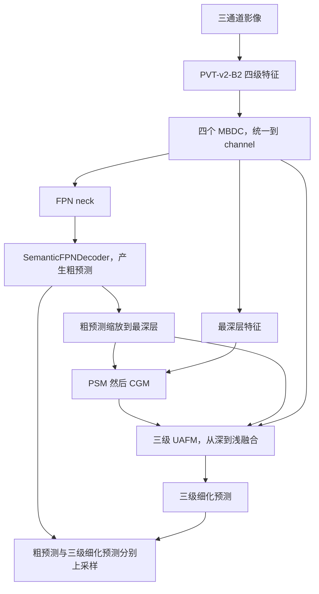

# PVT 第一阶段与 ResNet-50 骨干对照

模型已按骨干集中到少量脚本，完整函数定位见 [模型结构与函数索引](../model_structure.md)。阶段参数仅控制模块启用，训练入口保持不变。

后续阶段已实现，见 [UANet 分阶段说明](uanet_stages.md)。本文件保留第一阶段基线的结构与运行方式。

运行前在 `train.py` 选择 `METHOD="pvt"` 或 `METHOD="resnet50"`，不要沿用默认的 uanet 方法。

## 当前实现范围

本阶段接入 PVT-v2-B2，并另外提供 ResNet-50。两个骨干使用同一个 `SemanticFPNDecoder` 类、相同的通道投影方式和训练流程，分别训练、分别保存权重。

这不是完整 UANet，也不是已公开验证的 DFC2024 冠军水体模型。作者仓库是建筑提取 UANet；README 说明比赛方案在其基础上做过改进，没有给出足以原样复现比赛方案的全部配置。本阶段以公开的 `UANet_pvt` 代码为结构依据，先建立可运行、可对照的骨干实验。

## 代码位置与执行顺序

```text
src/
├─ datasets/water_dataset.py
├─ models/
│  ├─ unet.py
│  ├─ pvt.py
│  ├─ resnet.py
│  ├─ common.py
│  └─ checkpoint.py
├─ train.py         # METHOD 同级选择 unet、pvt、resnet50、uanet
└─ calibrate_bn.py  # 独立的可选 BN 校准
```

以 PVT 为例：在 `train.py` 设置 `METHOD="pvt"`，`main()` 调用 `create_trainer()` 选择 `PVTWaterNet`，直接创建 `WaterSegmentationTrainer`。训练器的 `train()` 顺序执行 `run_epoch(train)`、`run_epoch(val)` 和 `save_checkpoint()`。ResNet-50 在同一个入口选择 `METHOD="resnet50"`，没有模型专用训练器子类。

U-Net 的模型实现、训练默认值、优化器、AMP、数据划分和指标逻辑保持原样。公共训练器的提取已做整理前后的两轮合成数据回归，结果逐项一致；历史 BN 检查点可以严格加载。

## 512×512 SAR 输入的尺寸

| 步骤 | PVT-v2-B2 | ResNet-50 |
|---|---|---|
| 输入 | `[B,2,512,512]` | `[B,2,512,512]` |
| 第一级，步长 4 | `[B,64,128,128]` | `[B,256,128,128]` |
| 第二级，步长 8 | `[B,128,64,64]` | `[B,512,64,64]` |
| 第三级，步长 16 | `[B,320,32,32]` | `[B,1024,32,32]` |
| 第四级，步长 32 | `[B,512,16,16]` | `[B,2048,16,16]` |
| 各自 1×1 通道投影 | 四级通道均为 32，空间尺寸不变 | 同左 |
| 语义解码头 | 四支路对齐并相加为 `[B,32,128,128]` | 同左 |
| 1×1 分类与最终上采样 | `[B,2,512,512]` logits | 同左 |

PVT 的四级深度为 `[3,4,6,3]`，注意力头数为 `[1,2,5,8]`，MLP 扩张倍率为 `[8,8,4,4]`，空间缩减率为 `[8,4,2,1]`，DropPath 最大概率为 0.1，对照作者的 `pvt_v2_b2` 设置。这里使用标准 B2，不是 B2-Li 线性注意力变体。

ResNet-50 取四个残差阶段的输出，跳过步长为 2 的 stem 输出，以匹配 PVT 的四种尺度。它和 PVT 是可替换的骨干，没有串联在同一模型中。

解码头沿用作者的尺度处理方式：四个支路分别包含 1、1、2、3 个 `3×3 Conv → BN → ReLU`；后三支路每个卷积后上采样 2 倍。最终都对齐到第一级并相加，然后分类。支路内部 `align_corners=False`；最终预测上采样采用作者的 `align_corners=True`。

**SemanticFPNDecoder 和 FPN neck 是不同模块。** 当前有多尺度语义解码头，但还没有 FPN neck 的高层到低层逐级相加路径。

## 与公开完整模型的对应关系

作者 PVT 分支的实际流程是：



当前实际运行的是：

```text
两通道 SAR → PVT 或 ResNet-50 → 四个 1×1 投影 → SemanticFPNDecoder → logits
```

其中 1×1 投影是本项目为分阶段实验设置的简单适配层，不是作者 MBDC 的等价替代，也不能把当前结果记为完整 UANet 的指标。

后续分阶段修改位置：

1. **MBDC**：替换模型中的 `projections`。作者的三个分支是 1×1 分支、连续空洞率 4/8/16 的分支、连续空洞率 2/4/8 的分支，并包含拼接压缩和残差路径。
2. **FPN neck**：插入 MBDC 与当前解码头之间，保留粗预测出口。
3. **PSM、CGM、UAFM**：利用粗预测引导最深层增强，再由深到浅进行三级不确定性融合。不能遗漏 PSM/CGM 后仍称为完整公开结构。
4. **多输出监督**：完整 PVT 分支返回粗预测及三级细化预测，共四个全尺寸输出；到这一阶段再对照作者训练脚本核实损失与输出选择，不能把元组直接传给当前单输出交叉熵。

公开代码中 UAFM 使用前景通道的 sigmoid 与分段等级图，不是直接使用熵图；后续要明确按代码复现还是修改概率定义，并分别记录，不在本阶段偷偷替换。

## 预训练与两通道适配

默认 `PRETRAINED=True`：

- PVT：`timm` 的 `pvt_v2_b2.in1k`，ImageNet 预训练。
- ResNet-50：`resnet50.tv_in1k`，torchvision 来源的 ImageNet 预训练。
- 只加载骨干预训练参数，通道投影和语义解码头从随机初始化开始。
- `in_chans=2` 使用 timm 的输入卷积适配：取 RGB 权重的前两个通道并乘以 `3/2`，得到 `[输出通道,2,7,7]`。这只是初始化策略，不代表 RGB 通道和 SAR 极化具有对应物理含义。
- 仍使用本项目训练集的 SAR 均值、标准差；不改成 ImageNet 均值、标准差，不做 dB 转换。
- 第一次联网下载后缓存权重。下载失败会报错，不静默改为随机初始化。`PRETRAINED=False` 可进行离线随机初始化对照，但应使用另一个实验目录。

已有 U-Net 从随机初始化训练，所以它与预训练 PVT 的差异不仅包含网络结构，还包含初始化方式。PVT 与 ResNet-50 虽然都使用 ImageNet 权重，各自预训练配方也不完全一致，不能将结果差异完全归因于注意力或卷积。

## 运行与实验记录

在项目根目录、`sar-water` 环境中：

```powershell
python src/supervised/train.py
```

PVT 结果写入 `outputs/pvt_baseline/时间戳/`。ResNet-50 在同一入口改为 `METHOD="resnet50"` 后运行：

```powershell
python src/supervised/train.py
```

它写入 `outputs/resnet50_baseline/时间戳/`。两个入口不会互相覆盖，也不会写入 U-Net 目录。

当前仍是 batch size 2、20 轮、Adam、学习率 0.001、CUDA AMP、种子 42、内部验证比例 20%、交叉熵、无数据增强，按验证 loss 选择 best。这样先保持现有训练设置，但这不是对作者完整训练配方的复制，也不保证适合预训练骨干的最优收敛。作者公开 WHU 示例使用 VGG、AdamW/Lookahead、调度器和增强，不能当作已发布的 PVT 水体比赛配置。

检查点除原有数据划分、归一化、指标外，新增 `model_name`、`model_kwargs`、`backbone`、`decoder`、`pretrained`、`timm_version` 和阶段信息。`models/checkpoint.py` 据此重建模型，强制关闭预训练下载后严格加载完整权重。

可先将入口的 `MAX_SAMPLES=16`、`EPOCHS=2`，并把 `OUTPUT_DIR` 改成试跑目录检查日志；正式训练时恢复。固定种子保证划分一致，但不同骨干的初始化消耗不同随机数，训练打乱顺序和随机正则并不保证完全一致。

## BN 校准如何衔接

PVT 骨干使用 LayerNorm，没有 BN 运行统计量；**当前解码头仍含 7 个 BN**。ResNet-50 骨干与解码头都含 BN。不能因为使用了 PVT 就断定验证归零问题一定消失。

先检查原始训练曲线和预测，再按固定方案做校准对照。`calibrate_bn.py` 默认仍处理 U-Net。处理 PVT 时将顶部 `EXPERIMENT_DIR` 改为 `ROOT / "outputs/pvt_baseline"`，或者直接设置具体 `RUN_DIR`；ResNet-50 同理。

校准会依据检查点模型名重建网络，只修改 `BatchNorm2d` 的运行统计量，不修改 LayerNorm 或可学习参数。ResNet-50 的 BN 层较多，当前逐层遍历实现耗时会增加。原始成绩和校准后成绩都应保留，不能将不同校准条件的结果混为同一基线。

## 来源与核对边界

- [UANet 论文 DOI](https://doi.org/10.1109/TGRS.2024.3361211)：本轮 IEEE 正文访问受验证页面限制；具体代码结构以以下作者源码为直接依据。
- [作者 UANet 源码，固定提交](https://github.com/Henryjiepanli/Uncertainty-aware-Network/blob/66dfef3ae0c3e11981c7fa11dd5b296bb7f9a458/geoseg/models/UANet.py)。
- [作者 PVT 源码，固定提交](https://github.com/Henryjiepanli/Uncertainty-aware-Network/blob/66dfef3ae0c3e11981c7fa11dd5b296bb7f9a458/geoseg/models/pvtv2.py)。
- [PVT v2 论文](https://arxiv.org/abs/2106.13797)。
- [timm PVT 实现](https://github.com/huggingface/pytorch-image-models/blob/v1.0.30/timm/models/pvt_v2.py)：项目固定依赖 `timm==1.0.30`。

已将作者源码的同一组 PVT 参数严格映射到 timm，并对四尺度输出做数值比较，最大绝对差约 `2.9e-6`。这支持本轮检查输入上的前向一致性，不意味着两种库实现的所有训练随机过程逐位相同。完整实验精度仍待用户执行训练后检查。
