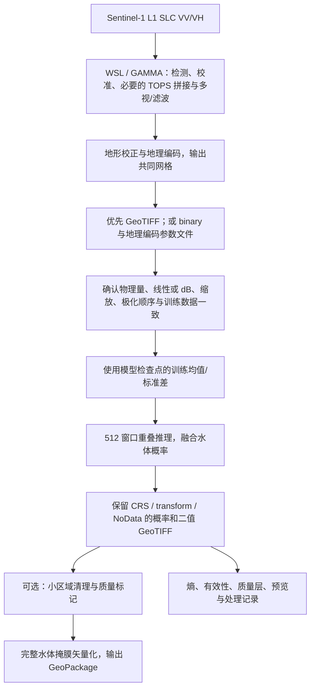

# GAMMA 处理的 Sentinel-1 SLC 到水体栅格与矢量：实施方案

**后续待办记录**：用户已明确当前优先使用现有 data 示例集；本方案暂不进入实现，不改变当前训练数据格式或数值处理。

## 当前结论与范围

用户的新数据为原始 Sentinel-1 L1 SLC，计划在 WSL/GAMMA 完成辐射校正和地理编码，可导出 binary 或 GeoTIFF。网络可以仅使用 VV/VH 两通道识别水体，DEM 不是当前模型的必需输入。

当前训练代码是通用语义分割流程：读取两个文件波段、排除文件掩膜无效和非有限像素、按训练集统计逐通道标准化、监督学习。它**没有实现** SLC 检测、多视、辐射校准、去斑、地形校正或 GAMMA 解码，也没有加入 SAR 物理散射模型、DEM 融合、VV/VH 比值或对数变换。

不过这不代表训练数据没有 SAR 前处理。DFC2024 总结说明 Sentinel-1 数据已经由 S1Tiling 校准、正射校正和滤波，并与 Sentinel-2 网格配准。Python 训练脚本接收的是处理后的切片。具体历史 S1Tiling 配方、校准类型及文件缩放不能仅凭该说明全部确定。

本文件是应用路径与输入契约分析。本轮没有增加完整场景推理/矢量导出脚本，也没有声称现有 DFC 权重已适用于新的 GAMMA 数据。

## DEM 有三个不同角色

| 角色 | 所在阶段 | 当前模型是否必须重训 |
|---|---|---|
| GAMMA 地形校正/地理编码使用 DEM | 网络前处理 | 不因使用这个 DEM 本身而重训；仍需匹配处理后的辐射和网格 |
| 将 DEM、坡度或入射角作为网络输入/融合分支 | 训练和推理 | 需要训练时见过这些通道，并让推理输入与之匹配 |
| 用坡度、阴影/叠掩、土地覆盖约束预测 | 质量控制或后处理 | 可以在固定网络后实验，但规则与阈值必须验证并另存原始预测 |

冠军 SAR 论文具体写的是融合土地覆盖数据中的指定水体区域，并非“所有辅助数据都在最后输入网络”。长期水体先验可能补全漏检，也可能把过时水域带入结果；DEM 高程或坡度阈值也可能误删山区水库。后处理应独立比较，不直接强制套用为默认规则。

## 推荐的数据流

## GAMMA 前处理需要明确的内容

1. **从复数 SLC 到检测功率**。SLC 的 I/Q 或幅度不能直接当作当前网络所见的强度。概念上检测功率为 `I²+Q²`；最终后向散射还需要正确应用 GAMMA 的校准及几何/面积因子，不能只平方就称为 sigma0。
2. **TOPS 接缝与子波束**。若是 IW/TOPS SLC，按覆盖范围处理 burst/subswath 的拼接和无效边缘，避免把接缝作为真实水体边界。网络不使用干涉相位，不需要为单景水体识别额外执行双时相干涉处理。
3. **多视与去斑**。根据目标地面网格、像元间距和训练集处理方式确定。输出像元间距不等于有效空间分辨率；重采样到 10 m 不会自动产生 10 m 的独立信息。额外强滤波可能抹去窄河，不应仅在新图上随意加入。
4. **校准类型**。必须记录得到的是 sigma0、gamma0、beta0 或其他归一化/地形平坦化后的量，是否线性功率、是否乘了比例因子。地理编码与辐射地形平坦化是不同操作，不能互相替代。
5. **共同地理网格**。VV/VH 必须同 CRS、同 transform、同分辨率和同覆盖范围；分别导出时也要保持严格对应。按投影网格处理面积更清楚，但最终空间尺度仍需与训练集匹配。
6. **有效性和质量掩膜**。保留边界、无覆盖、插值空洞以及可获得的阴影/叠掩标记。地理编码不会使阴影区域恢复真实可观测散射；不应把所有低回波一律判水。

不在此给出未经本地 GAMMA 版本核实的具体命令行参数。你可沿用已有 GAMMA 处理链，再按上述输出信息衔接推理。

## 选择 GeoTIFF 还是 binary

**第一版推荐：两个单波段 GeoTIFF，明确 VV 与 VH；也可为明确标注极化顺序的双波段 GeoTIFF。** 推荐 float32，保存处理后的物理量，携带 CRS、仿射变换与明确 NoData。对模型而言，GeoTIFF 不是精度更高，而是更容易可靠传递地理与数值信息。

GAMMA binary 同样可用，但必须伴随以下信息：

- 逐文件对应的极化、影像宽度与行数。
- 数据类型，明确是复数 SLC、实数幅度还是校准强度；本推理接口应接收后两者中经过契约明确的校准量，当前目标为实数后向散射。
- 字节序、是否包含文件头、NoData 或外部有效性掩膜。不要盲目假定所有文件都是 native float32 或 big-endian float32。
- **对应地理编码网格**的参数文件，例如记录投影、宽高、起始坐标和像元间距的 DEM/地图参数。雷达坐标下的 SLC `.par` 不能替代它。
- 根据实际投影核对 `corner_lat/lon` 或投影坐标、`post_lat/lon` 或投影像元间距的含义；坐标代表像元中心还是角点需要确认，避免半像素偏移。
- 校准类型、单位、scale/offset、处理日期和传感器/轨道信息。

读取二进制后应先验证重建的幅面、地理范围与 GAMMA 显示结果一致，再转换为内部共同栅格。仅能 reshape 成一个矩阵，不代表字节序、空间方向或投影正确。

## dB 不是推理时任意开启的显示选项

对于已校准的正线性功率 `s`：`s_db=10 log10(s)`；反变换为 `s=10^(s_db/10)`。幅度和功率的对数系数不同，不能混用；原始 DN 还可能需要校准 LUT 或面积因子。

当前模型直接在 DFC 文件的原始存储值上估计均值/标准差。实际抽查本地 `0.tif`：6 个波段，描述/单位为空，scale=1、offset=0、无 CRS、单位仿射变换。它无法单独证明前两通道的物理极化顺序、校准量或整数缩放公式。

因此，**不能把 GAMMA 的负 dB 值直接送进按当前原始数值训练的模型，也不能猜测乘以 10000 就已经匹配。** 即使把两幅图各自归一化到均值 0、方差 1，也不能保证不同的非线性变换、滤波和地形归一化变成同一物理分布。

优先路径：确认 DFC 的原始波段说明、校准/缩放配方，建立 GAMMA 输出到训练表示的明确转换，再使用现有 checkpoint 的 mean/std。若确认其为某种线性功率的缩放值，按已证实公式转换；若证明与所选 GAMMA 量不同，应调整前处理或重新训练相应表示，不能靠直方图相似来证明物理一致。

未来可为全部训练与推理制定统一的 sigma0 线性或 dB 契约，但选择 dB 后必须让训练数据按同一规则转换并重训/验证；不能只改新图。不要自行套用其他数据集的 dB 截断范围。

## 整景推理与栅格结果

完成上述对齐后，输入一个在该传感器/处理条件上经过验证的训练模型。旧简单 PVT 的权重只能加载原简单结构，新 full 网络需要其自己的训练权重。

建议按 512×512 窗口推理，首版可采用 128 像素重叠、步长 384（这是工程起点，需做接缝检查）。边缘窗口补齐，补齐位置不计入有效输出。各通道使用 checkpoint 的训练均值/标准差，无效位置在标准化后填 0；不能重新以整景统计量替换训练统计量。

完整 UANet 用最后一个细化头，水体概率为 `softmax(logits,dim=1)[:,1]`。重叠区域先融合概率，再生成分类图；边缘权重可平滑，但场景边界的有效权重不能为零，所有有效像素都应有覆盖。简单 baseline 默认以两个类别 argmax 决策，相当于水体概率超过约 0.5；若调整阈值，应由有标签验证样本决定并记录。

| 输出 | 建议数据形式 | 内容 |
|---|---|---|
| `water_probability.tif` | float32 GeoTIFF，NoData=-9999 | 融合后的水体概率 0~1 |
| `water_mask_raw.tif` | uint8 GeoTIFF，NoData=255 | 原始分类，0 非水、1 水体 |
| `water_mask.tif` | uint8 GeoTIFF，NoData=255 | 有启用清理时的最终分类；与原始结果分别保留 |
| `uncertainty_entropy.tif` | float32 GeoTIFF，NoData=-9999 | 归一化二分类预测熵；是置信不确定性指标，不是已知误差真值 |
| `quality_mask.tif` | 位编码或明确定义的整数 GeoTIFF | 无覆盖、阴影/叠掩等可用质量标记 |
| `water.gpkg` | GeoPackage Polygon/MultiPolygon 图层 | 水体范围及面积、概率/熵统计等属性 |
| `preview.png`、处理记录 | 预览与文本/元信息文件 | SAR、概率、掩膜叠加及模型、阈值、数据处理来源 |

所有地理栅格继承**新地理编码影像**的 CRS、transform、宽高与有效范围，不继承训练切片的单位矩阵。无效像素是未知，不编码为可靠的非水体。数据类型、NoData 和概率范围应在实际落盘后核验。

## 水体矢量怎么生成

先在整景公共网格上融合掩膜，再用 `rasterio.features.shapes(mask, mask=valid_water, transform=source_transform)` 对值 1 进行 polygonize；保存为 GeoPackage。不要按每块先输出独立矢量再直接拼接，以免产生大量切片边界裂缝和重复面。

首版保留岛屿和内孔，明确 4/8 邻域策略；矢量写出前检查几何有效性。小斑块清理依据面积阈值，默认应先关闭，以免删除窄河和小塘。若要计算 `area_m2`，需使用适当的米制投影或椭球面积，不能把经纬度坐标面积直接当平方米；简化容差也要考虑 CRS 单位和像元分辨率。

建议属性包括 `water_id`、`area_m2`、`mean_probability`、`mean_entropy`、数据日期、模型标识和分类阈值。Shapefile 可作为可选导出，但 GeoPackage 更适合较长字段、中文与多图层。实际实现可使用 Rasterio 加 GeoPandas/Fiona 或 pyogrio，不手写栅格轮廓追踪算法。

## 单景水体不等于洪水新增范围

单景 VV/VH 输出的是该时刻的可识别水体范围。要得到“应灾新增淹没”，还需要灾前水体或可靠长期背景、时间对应和共同网格，并评价季节水位、阴影、轨道差异等造成的伪变化。不能只凭单景水体掩膜将永久水域全部标为灾害淹没。

## 建议实施顺序

1. 当前先完成 `mbdc → fpn → uafm → full` 的独立训练对照，保留原始 PVT 的指标与预测。
2. 并行确认 DFC 输入表示，记录 GAMMA 输出量、单位与网格。第一份新样例优先导出两幅 VV/VH GeoTIFF；binary 则配齐地理编码参数。
3. 确认匹配后再实现 `src/predict_water.py`，配合 `src/inference/` 保存整景窗口融合和矢量化职责，顶部直接设变量，复用 `models.checkpoint.load_model`。
4. 先在一小块新区域上核对原始 SAR、概率、预测与地理叠加；有标注/独立参考时计算指标，再运行整景和矢量输出。
5. 阴影/地形及长期水体规则作为可开关后处理另做对照；多源网络融合属于后续重新训练的结构实验。

## 来源

- [本地 DFC2024 总结正式论文](papers/2026_DFC2024_RapidFloodMapping_JSTARS_Published.pdf)：数据前处理、冠军输入与集成/后处理、场景拼接与五折说明。
- [本地 SAR UAFNet 论文](papers/2024_UAFNet_SARFloodMapping_IGARSS_Published.pdf)：模型、三通道输入与实验设置。
- [S1Tiling 数据流](https://s1-tiling.pages.orfeo-toolbox.org/s1tiling/master/dataflow-main.html) 与 [配置说明](https://s1-tiling.pages.orfeo-toolbox.org/s1tiling/latest/configuration.html)：校准类型、热噪声和处理配置是不同选项，不能由整数值范围猜出。
- [ESA SNAP 辐射校准说明](https://step.esa.int/main/wp-content/help/versions/10.0.0/snap-toolboxes/eu.esa.microwavetbx.sar.op.calibration.ui/operators/CalibrationOp.html)。
- [Rasterio 栅格/矢量转换说明](https://rasterio.readthedocs.io/en/stable/topics/features.html)。
