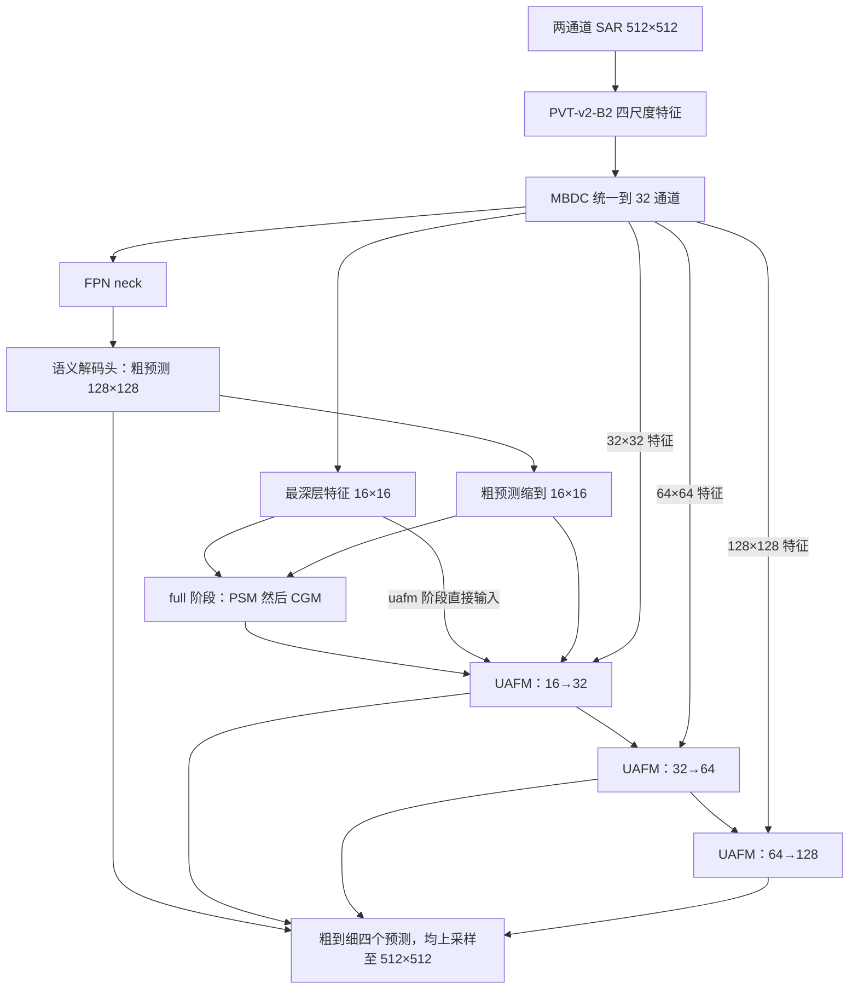

# PVT-UANet 分阶段实现与 SAR 适配

模型已按骨干集中到少量脚本，完整函数定位见 [模型结构与函数索引](../model_structure.md)。阶段参数仅控制模块启用，训练入口保持不变。

## 当前代码组织

```text
src/
├─ datasets/water_dataset.py
├─ models/
│  ├─ unet.py
│  ├─ pvt.py
│  ├─ resnet.py
│  ├─ common.py
│  └─ checkpoint.py
├─ train.py         # METHOD 同级选择 unet、pvt、resnet50、uanet
└─ calibrate_bn.py  # 独立的可选 BN 校准
```

所有可调参数仍位于入口顶部，没有 argparse、配置框架或自动切换阶段。新增模块使用类，forward 顺序表达计算流程。已有 PVT 基线没有被覆盖。

## 如何逐步运行

在 `train.py` 顶部设置 `METHOD="uanet"`，再设置 `STAGE`，运行：

```powershell
conda activate sar-water
python src/train.py
```

| STAGE | 激活模块 | 输出数量 | 实验目录 |
|---|---|---:|---|
| `mbdc`，当前默认 | PVT → 四层 MBDC → 语义解码头 | 1 | `outputs/pvt_uanet_mbdc/时间戳/` |
| `fpn` | PVT → MBDC → FPN → 语义解码头 | 1 | `outputs/pvt_uanet_fpn/时间戳/` |
| `uafm` | 上述粗预测 → 三级 UAFM，不含 PSM/CGM | 4 | `outputs/pvt_uanet_uafm/时间戳/` |
| `full` | 加入 PSM → CGM，再进入三级 UAFM | 4 | `outputs/pvt_uanet_full/时间戳/` |

建议按表中顺序分别执行、分析指标和预测后再切换。PSM/CGM 的输出本身不是新的分类预测，因此不另设一个只有先验增强、却不使用增强结果的无效实验阶段；它们在 `full` 阶段配合 UAFM 接入。

各阶段均从 ImageNet 骨干和新建的解码模块初始化，**不是自动加载上一阶段 last/best 接着训练**。固定划分、batch size 2、20 轮、Adam、1e-3、AMP 等沿用当前对照设置。论文的 AdamW、初始 1e-4、cosine、增强和模型集成留作后续独立实验，不与结构改动同时混入。修改 `STAGE` 后 `OUTPUT_DIR` 自动对应阶段；修改试跑轮数或样本数量时仍应自行指定试跑目录。

## 结构与尺寸

512×512 输入经过 PVT 后，特征分别为 `[B,64,128,128]`、`[B,128,64,64]`、`[B,320,32,32]`、`[B,512,16,16]`。四层 MBDC 都输出 32 通道，空间尺寸保持不变。



FPN 的输出用于产生粗预测；UAFM 的浅层输入来自 **MBDC 特征**，不是把四层 FPN 输出再串入 UAFM。这个连接关系按公开作者代码保留。

模块职责：

- **MBDC**：三分支分别为 1×1 卷积、连续空洞率 4/8/16、连续空洞率 2/4/8；拼接后压缩并与投影残差相加。
- **FPN**：四层 1×1 侧向卷积、自顶向下最近邻上采样相加、各层 3×3 输出卷积。
- **PSM**：用最深层特征和粗预测构造逐通道空间注意力；只在最小尺度计算。
- **CGM**：各通道与前景预测的空间内积经 sigmoid 后作为通道权重。PSM/CGM 的 gamma 初始为 0，从恒等映射开始学习。
- **URA/UAFM**：分前景、背景两侧估计等级，乘入对应尺度特征；拼接、卷积、上采样后融合，输出新的细化预测。

## 损失、评价与保存

新增多输出阶段返回 `(coarse, refined_32, refined_64, refined_128)`，每一项均已上采样至输入大小，最后一个头是最终结果。

当前按公开训练代码使用：

\[
L_{train}=\sum_{k=1}^{4}\mathrm{CE}(M_k,Y),\qquad
L_{val}=\mathrm{CE}(M_{last},Y).
\]

所有头都忽略标签 -1；训练指标、验证指标、推理和校准评价都使用最后一个头。单输出基线仍只有一个 CE。多输出阶段的训练 loss 是四项之和，不能直接与单输出基线的训练 loss 数值比较，也不能仅凭 train loss 大于 val loss 判断过拟合。

正式论文文字写 BCE，而公开建筑代码实际配置 `nn.CrossEntropyLoss`、两个类别 logits，并等权相加多个输出。本项目按**公开代码的双通道 CE 路径**实现，不将其称为论文单通道 BCE 的逐项复现。

检查点保存 `model_name='pvt_uanet'`、具体 `stage`、`model_kwargs`、输入通道、归一化、划分及监督说明。重建时关闭预训练下载并严格加载完整权重。不同阶段的头/neck 结构不同，不能把旧 PVT 权重文件当成完整 UANet 权重使用。

## 必须区分的三种对象

1. **公开建筑 PVT-UANet**：具有 PSM/CGM，代码包含三级活动 UAFM。`full` 对照其活动计算路径；原类额外声明但未使用的 `ufm_layer1` 未注册。
2. **SAR UAFNet 论文**：架构图不包含 PSM/CGM，采用 VH/VV/VH 三通道、多个 PVT 版本、增强和集成，并利用土地覆盖指定水体区域做后处理。`uafm` 是其无 PIGM 结构方向的两通道适配，但具体卷积、权重及训练配置仍以公开建筑代码为基础。
3. **本项目**：当前仅使用文件第 1/2 通道，物理单位与极化顺序未从元数据确认；采用固定随机切片划分及现有训练参数。不能将本项目成绩直接与作者 82.985% 官方测试 F1 作同条件比较。

## 论文和代码的具体差异

保留以下公开代码行为，并在实验中明确记录：

- UAFM 使用 `sigmoid(logits[:,1])`，不是双类别 softmax 的水体概率；两者在 CE 双 logits 下不等价，不能把这个值直接当校准概率。
- rank 使用原始 0~5 等级；2026 比赛总结提到可映射为 rank/5，本轮未混入该缩放。
- 恰好 sigmoid=0.5 时，严格大于号使前后景 rank 都为 0；论文区间描述与此边界不完全一致。
- 公开代码先对前景 logits 做双线性插值，再重新分级；SAR 论文描述的是对等级图进行最近邻上采样。
- 公开代码 UAFM 高/低支路为 3×3，输出分类为 1×1；SAR 论文部分公式写 1×1 支路与 3×3 分类。MBDC 压缩卷积的描述也与代码存在差异。
- 本轮保留代码行为，以便数值对照。若后续修改为 softmax、rank/5 或论文卷积设置，应作为独立配置与实验，不能静默改变现有结果。

## 验证与现有 PVT 成绩

7 个模型相关离线测试通过，覆盖四个阶段、非整除尺寸、多输出梯度、严格重载及训练/校准评价一致性。真实 SAR `[2,2,512,512]` 的 `mbdc` 和 `full` GPU 前向、深监督反向、参数更新及 float32 eval 已检查通过；未执行完整新阶段训练。

同一权重、同一输入下，与作者公开活动网络路径对照，四个输出最大差约 `1.2e-7`。该比较使用相同 timm 骨干、相同已验证语义头，PSM/CGM gamma 设置为非零，验证其余模块和连接；不宣称全训练过程逐位相同或新的精度已经达标。

已完成 PVT 基线 `20261019_135057_507470`：保存 best 对应第 15 轮，val loss 0.103412、F1 0.743646、IoU 0.591909。日志最高 F1 为第 13 轮 0.750800，但模型按 loss 选择，不能把日志最高 F1 误称为 best.pth 指标。这里只读取日志，未重新完整评估其模型。

## 依据

- [作者公开模型代码（固定提交）](https://github.com/Henryjiepanli/Uncertainty-aware-Network/blob/66dfef3ae0c3e11981c7fa11dd5b296bb7f9a458/geoseg/models/UANet.py)。
- [作者公开训练代码（固定提交）](https://github.com/Henryjiepanli/Uncertainty-aware-Network/blob/66dfef3ae0c3e11981c7fa11dd5b296bb7f9a458/train.py)。
- [建筑 UANet 正式论文](../papers/2024_UANet_BuildingExtraction_TGRS_Published.pdf)，图 2–4 与损失说明。
- [SAR UAFNet 比赛论文](../papers/2024_UAFNet_SARFloodMapping_IGARSS_Published.pdf)，图 2、式 8、实验设置。
- [DFC2024 总结正式论文](../papers/2026_DFC2024_RapidFloodMapping_JSTARS_Published.pdf)，Track 1 First Place 的预处理、结构和后处理说明。
