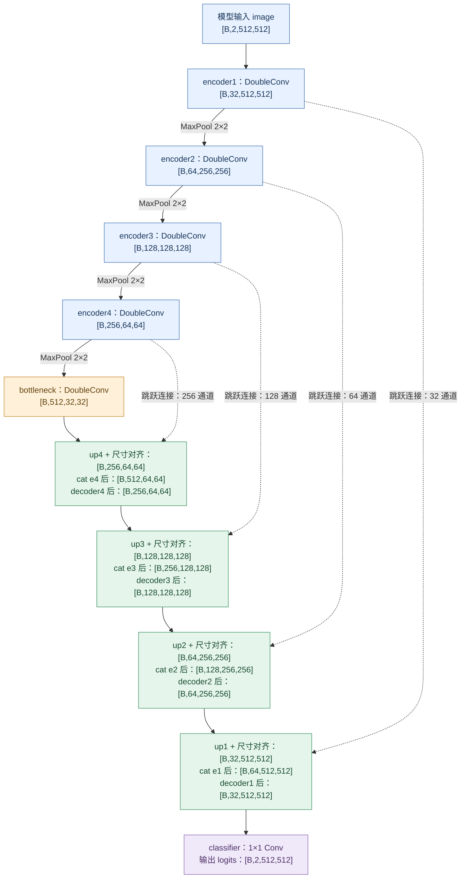
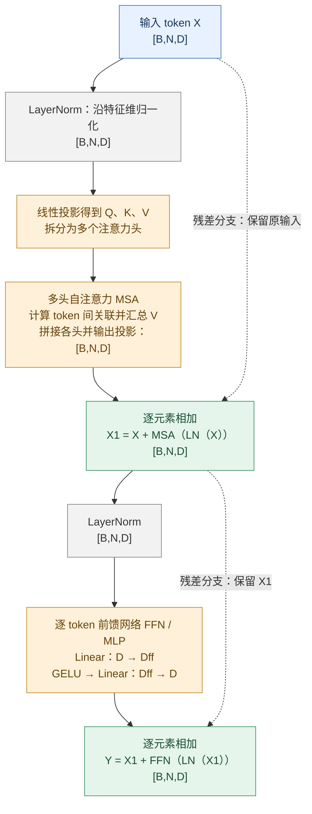
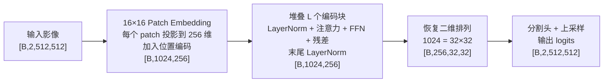

# U-Net 函数含义与计算推导

本文对应 [src/supervised/models/unet.py](../src/supervised/models/unet.py)，整理网络中各个函数的作用、数据尺寸变化，以及卷积、转置卷积和跳跃连接的计算过程。

公共 `BasicConv2d`、`DoubleConv` 位于 [基础卷积模块](../src/supervised/models/common.py)，完整网络仅负责组合它们。各模型的函数定位见 [模型结构与函数索引](model_structure.md)。

默认参数为 `in_channels=2`、`num_classes=2`、`base_channels=32`。以下主要使用输入 `[B, 2, 512, 512]`，其中 `B` 为批次数量。输入的两个通道按文件选择，本文不根据网络结构推断其极化或物理单位。

## 1. 张量尺寸与整体结构

PyTorch 二维卷积通常使用 `[B, C, H, W]`：

| 维度 | 含义 |
|---|---|
| `B` | 一个批次中的样本数量 |
| `C` | 输入波段数或中间特征通道数 |
| `H` | 高度 |
| `W` | 宽度 |

网络的数据流为：

```text
输入影像
   ↓
编码器：缩小高宽，增加特征通道，提取上下文
   ↓
瓶颈层：最小空间尺度上的特征处理
   ↓
解码器：扩大高宽，结合编码器的同尺度特征
   ↓
1×1 卷积：生成每个像素的类别分数
```

中间的 32、64、128 等通道是学习得到的特征图，不是新增的 SAR 极化或观测波段。

### 1.1 当前 U-Net 的实际网络流程

下图对应 `src/supervised/models/unet.py`，采用默认参数。蓝色为编码特征，橙色为瓶颈，绿色为解码特征，紫色为输出。实线表示主计算流程，虚线表示从编码器送往解码器的跳跃连接。



每个绿色框内部的顺序都是：**转置卷积上采样 → 插值对齐 → 与对应编码特征按通道拼接 → DoubleConv**。虚线输入在其中的 `cat` 步骤接入，不参与该框最前面的转置卷积。

例如最深一级：`center` 的 512 个通道先变为 256 个通道；再与 `e4` 的 256 个通道拼接成 512 个通道；最后由 `decoder4` 融合成 256 个通道。转置卷积与拼接的详细计算见后文第 9、11 节。

### 1.2 Transformer 编码块原理图：概念对照

**当前 U-Net 没有 Transformer。** 下图用于理解视觉 Transformer 如何组织特征，采用 ViT 常见的 Pre-LN 编码块：每个注意力或前馈子层前先做 LayerNorm，子层后进行残差相加。

输入 `[B,N,D]` 中，`N` 为 token 数量，`D` 为每个 token 的特征维度。图中省略 Dropout 等细节，实际模型需要以具体实现为准。



自注意力在不同 token 之间交换信息；FFN 通常对每个 token 分别使用同一组网络参数。残差连接做逐元素相加，要求参与相加的张量形状一致，不会像 U-Net 的 `cat` 那样增加通道数。

单个注意力头可概括为：

$$
\operatorname{Attention}(Q,K,V)
=\operatorname{softmax}\left(\frac{QK^T}{\sqrt{d_k}}\right)V
$$

`d_k` 为该注意力头的 Q、K 特征维度。这里的 softmax 对注意力分数归一化，不是最终水体类别的 softmax。

### 1.3 图像如何接入 Transformer 并得到分割结果

下面是单尺度视觉 Transformer 用于分割的概念路线。示例使用 `16×16` patch、`D=256`，仅用于说明尺寸，不是当前代码已实现的配置。保留空间 token，不添加用于整图分类的 CLS token。



token 数为 `N=(512/16)×(512/16)=1024`。转回二维排列时，只是恢复 token 对应的空间位置，不会自动恢复 patch 内细节；后面的分割头需要承担预测与分辨率恢复任务。

PVT 等层级式视觉 Transformer 会进一步组织多尺度特征，与这里的单尺度示意不同。因此，以上两张 Transformer 图既不是当前 U-Net 的组成部分，也不是比赛 UAFNet/PVT 的完整实现图。

### 1.4 两类结构的阅读对照

名称区分：当前代码中的 `ConvTranspose2d` 是转置卷积，用于图 1.1 的上采样；它与基于注意力的 Transformer 不是同一种模块。转置卷积的数值例子与公式见第 9 节。

| 比较项 | 当前 U-Net | 上述 Transformer 编码块 |
|---|---|---|
| 基本特征组织 | 二维特征图 `[B,C,H,W]` | token 序列 `[B,N,D]` |
| 主要信息交互 | 局部卷积，通过多层和下采样扩大感受野 | 自注意力计算 token 间关联 |
| 归一化层 | DoubleConv 内的 BatchNorm2d | LayerNorm |
| 连接方式 | 编码/解码特征按通道拼接，增加通道数 | 同形状特征逐元素残差相加 |
| 尺度变化 | 池化缩小、转置卷积扩大高宽 | 当前示意编码块保持 token 数与特征维度不变 |
| 分割输出 | 逐级解码后接 1×1 卷积 | 需要另外设计分割头和空间分辨率恢复方式 |

Transformer 图的结构参考：[ViT 原论文](https://arxiv.org/abs/2010.11929)、[Attention Is All You Need](https://arxiv.org/abs/1706.03762)。其中图示编码块采用 Pre-LN，不能据此把原始 Transformer 的所有实现都视为相同的归一化顺序。

以上图采用 Mermaid，可在支持 Mermaid 的 Markdown 预览中查看；代码块保留了可编辑的节点、连接和尺寸标注。

## 2. 导入的模块

```python
import torch
from torch import nn
from torch.nn import functional as F
```

- `torch`：提供张量、自动求导及 `cat`、`randn` 等操作。
- `nn`：提供具有模块结构的网络层，例如 `Conv2d`、`BatchNorm2d`。
- `F`：`torch.nn.functional` 的别名，这里用于直接调用插值操作 `F.interpolate`。

卷积层需要保存和学习权重，所以在初始化阶段建立为模块；插值本身没有可学习参数，在 `forward()` 中直接调用。

## 3. 类、初始化与 `super()`

### 3.1 `class DoubleConv(nn.Sequential)`

`DoubleConv` 继承 `nn.Sequential`，把多个网络层按排列顺序依次执行：

```text
卷积 → BatchNorm → ReLU → 卷积 → BatchNorm → ReLU
```

由于 `nn.Sequential` 已提供顺序执行的逻辑，`DoubleConv` 无需自己编写 `forward()`。

### 3.2 `class UNet(nn.Module)`

`UNet` 继承 `nn.Module`，获得 PyTorch 对子模块、参数、设备和训练状态的管理能力。U-Net 有多条跳跃连接，不能只描述成单一路径，因此通过自定义 `forward()` 组织计算。

### 3.3 `__init__()` 和 `self`

```python
def __init__(self, in_channels=2, num_classes=2, base_channels=32):
```

`__init__()` 在创建对象时执行，负责建立网络层。`self` 表示当前对象。

```python
model = UNet()
```

创建模型时会执行 `UNet.__init__()`；此时卷积层的权重已经建立，但还没有输入影像参与计算。

```python
self.encoder1 = DoubleConv(in_channels, c)
```

这句话把卷积模块保存为模型的属性，并由 PyTorch 注册为子模块。后续 `model.parameters()` 才能找到它的参数。

### 3.4 `super().__init__()` 的准确含义

`super()` 返回一个沿方法解析顺序（MRO）查找后续实现的代理；`.__init__()` 才是在调用初始化方法。在本脚本的单继承关系里，可理解为先调用父类初始化。

```python
class UNet(nn.Module):
    def __init__(self, ...):
        super().__init__()
        self.encoder1 = ...
```

这里先初始化 `nn.Module` 管理子模块和参数所需的内部结构，再添加自己的网络层。如果省略它，随后给模型赋值卷积等子模块通常会报错。

`DoubleConv` 的写法则是：

```python
super().__init__(
    nn.Conv2d(...),
    nn.BatchNorm2d(...),
    nn.ReLU(...),
    ...
)
```

因为父类是 `nn.Sequential`，可以直接把各层传给父类，让它组织执行顺序。

| 情况 | 是否需要显式调用 |
|---|---|
| 继承 `nn.Module`，并自己编写 `__init__()` | 应先调用 `super().__init__()` |
| 子类没有编写 `__init__()` | 可以直接继承已有初始化方法，无需重复写 |
| 普通类，没有需要初始化的父类功能 | 通常不必调用 |
| 在 `forward()` 中完全定义自己的计算 | 不需要调用 `super().forward()`；`nn.Module` 默认没有实现该网络计算 |

`super()` 也能调用其他继承方法，例如 `super().some_method()`，并非只用于初始化。多继承时不能简单把它等同于“固定调用某一个父类”。

## 4. `nn.Conv2d()`：提取局部特征

```python
nn.Conv2d(in_channels, out_channels, 3, padding=1, bias=False)
```

| 参数 | 本脚本中的含义 |
|---|---|
| `in_channels` | 输入特征通道数 |
| `out_channels` | 要学习的输出特征通道数 |
| `3` | 卷积核为 `3×3` |
| `padding=1` | 在边缘补一圈 |
| 默认 `stride=1` | 卷积窗口每次移动一个像素 |
| `bias=False` | 不设置卷积偏置；后接 BatchNorm，包含可学习的平移参数 |

### 4.1 为什么保持高宽不变

普通二维卷积的高度公式为：

$$
H_{out}=\left\lfloor\frac{H_{in}+2p-d(k-1)-1}{s}+1\right\rfloor
$$

其中 `p` 为 padding，`d` 为 dilation，`k` 为核大小，`s` 为 stride。宽度同理。

本脚本取 `p=1`、`d=1`、`k=3`、`s=1`：

$$
H_{out}=\frac{H_{in}+2-2-1}{1}+1=H_{in}
$$

所以 `DoubleConv(2, 32)` 内部的尺寸变化为：

```text
[B,  2, 512, 512]
        ↓ 第一次卷积、BatchNorm、ReLU
[B, 32, 512, 512]
        ↓ 第二次卷积、BatchNorm、ReLU
[B, 32, 512, 512]
```

### 4.2 输出通道从哪里来

当 `groups=1` 时，每一个输出通道都综合所有输入通道的局部邻域：

$$
Y[b,o,i,j]=\sum_c\sum_{u=0}^{2}\sum_{v=0}^{2}
W[o,c,u,v]\,X_{pad}[b,c,i+u,j+v]
$$

这里省略偏置，因为当前双卷积设置了 `bias=False`。不同输出通道有不同的权重，因此可以学习不同的特征。

普通卷积的权重排列为 `[Cout, Cin, Kh, Kw]`。第一层 `2 → 32` 的权重数为：

$$
32\times2\times3\times3=576
$$

## 5. `nn.BatchNorm2d()`：调整中间特征的分布

```python
nn.BatchNorm2d(out_channels)
```

训练时，对每个通道分别在批次与空间维度上计算统计量，可概括为：

$$
\hat{x}_{b,c,i,j}=\frac{x_{b,c,i,j}-\mu_c}{\sqrt{\sigma_c^2+\epsilon}},
\qquad y_{b,c,i,j}=\gamma_c\hat{x}_{b,c,i,j}+\beta_c
$$

`gamma` 和 `beta` 是可学习参数，`epsilon` 用于数值稳定。形状保持不变。

本脚本使用默认的运行统计机制：训练模式会更新运行统计量，评估模式通常使用保存的统计量。

它处理的是网络中间特征；训练脚本对原始影像计算均值和标准差，是另外一层输入预处理。BatchNorm 本身也不能替代 ReLU 引入的非线性。

## 6. `nn.ReLU()`：引入非线性

```python
nn.ReLU(inplace=True)
```

$$
\operatorname{ReLU}(x)=\max(0,x)
$$

正值保留，负值变成零，张量尺寸不变。这里处理的是卷积后的特征，不是在数据读取阶段直接删除原始影像的负值。

`inplace=True` 表示尽可能直接在当前张量上完成修改，减少额外内存分配。

## 7. `nn.MaxPool2d(2)`：减小空间尺寸

```python
self.pool = nn.MaxPool2d(2)
```

默认步长也是 2，每个通道独立对 `2×2` 区域取最大值：

```text
输入局部区域      池化输出
1  4
2  3       →       4
```

因此 `[B,32,512,512] → [B,32,256,256]`，通道数不变。对于奇数高宽，默认采用向下取整，例如 `65 → 32`。

`self.pool` 在不同层重复使用；最大池化没有可学习权重。各个 `DoubleConv` 则是分别建立的独立模块，不共享卷积权重。

## 8. `forward()`：执行编码和解码

```python
output = model(image)
```

调用模型时，PyTorch 的模块调用机制会执行 `forward(image)`，同时管理相关钩子。通常使用 `model(image)`，而不直接调用 `model.forward(image)`。

例如：

```python
e2 = self.encoder2(self.pool(e1))
```

从内向外执行：先池化，再双卷积。前者改变空间尺寸，后者改变通道数。

### 8.1 编码与瓶颈尺寸

| 变量 | 计算 | 输出尺寸 |
|---|---|---|
| `image` | 输入 | `[B,2,512,512]` |
| `e1` | `encoder1(image)` | `[B,32,512,512]` |
| `e2` | `encoder2(pool(e1))` | `[B,64,256,256]` |
| `e3` | `encoder3(pool(e2))` | `[B,128,128,128]` |
| `e4` | `encoder4(pool(e3))` | `[B,256,64,64]` |
| `center` | `bottleneck(pool(e4))` | `[B,512,32,32]` |

逐层下采样扩大后续特征的感受野，使深层能够利用更大范围的上下文，但也降低了空间分辨率。

## 9. `nn.ConvTranspose2d()`：学习上采样

当前第一层上采样为：

```python
self.up4 = nn.ConvTranspose2d(c * 16, c * 8, 2, stride=2)
```

代入 `c=32`：

```python
nn.ConvTranspose2d(512, 256, kernel_size=2, stride=2)
```

它同时学习通道融合和空间扩展，实现：

```text
[B,512,32,32] → [B,256,64,64]
```

### 9.1 一个输入值如何生成四个输出值

先看单输入通道、单输出通道，并把偏置设为 0：

```text
输入值       2×2 权重        输出区域

              1  2           3   6
  3     ×     3  4     =     9  12
```

一个输入位置的值与核的四个权重相乘，生成一个 `2×2` 区域。权重由训练学习，例子中的数字只用于说明。

### 9.2 `stride=2` 如何安排输出位置

当前 padding 为 0。输入 `(i,j)` 生成的区域从输出 `(2i,2j)` 开始：

| 输入位置 | 输出区域 |
|---|---|
| `(0,0)` | 第 0～1 行，第 0～1 列 |
| `(0,1)` | 第 0～1 行，第 2～3 列 |
| `(1,0)` | 第 2～3 行，第 0～1 列 |

在本层 `kernel_size=stride=2` 的设置下，相邻输入位置生成的区域恰好相邻，不发生空间重叠。其他核大小与步长组合可能产生重叠，重叠位置的贡献会相加。

### 9.3 为什么 `32×32` 变成 `64×64`

转置卷积的高度公式为：

$$
H_{out}=(H_{in}-1)s-2p+d(k-1)+p_{out}+1
$$

`p_out` 是 `output_padding`，其作用是控制输出尺寸的歧义，不应简单理解成在结果边缘额外填零。

本层取 `s=2`、`p=0`、`d=1`、`k=2`、`p_out=0`：

$$
H_{out}=(32-1)\times2+1\times(2-1)+1=64
$$

宽度同理，批次维度 `B` 不变。

### 9.4 为什么 512 个通道变成 256 个

每个输出通道接收全部 512 个输入通道的贡献，每个“输入通道 → 输出通道”连接各有一个 `2×2` 核。

```text
输入通道 1   × 对应核 ─┐
输入通道 2   × 对应核 ─┤
          ……          ├→ 相加，得到某个输出通道的 2×2 区域
输入通道 512 × 对应核 ─┘
```

一共建立 256 组这样的输出组合，生成 256 个输出通道。不是把相邻两个通道简单平均，也不是把通道数变化与空间扩展分成两个独立步骤。

在当前无空间重叠的设置下，准确表达为：

$$
Y[b,o,2i+u,2j+v]
=\sum_{c=0}^{511}X[b,c,i,j]\,W[c,o,u,v]+\operatorname{bias}[o]
$$

其中 `u,v` 各取 0 或 1。

### 9.5 两个输入通道的数值例子

把问题缩小为 `[1,2,1,1] → [1,1,2,2]`：输入两个通道的值为 3、5，两个连接核分别为：

```text
W[0,0]       W[1,0]
1  0         0  1
0  1         1  0
```

偏置为 0 时，唯一输出通道是：

```text
    1  0       0  1       3  5
3 × 0  1 + 5 × 1  0   =   5  3
```

这个例子同时展示了输入通道融合和空间扩展。

### 9.6 权重尺寸和参数量

当 `groups=1` 时，PyTorch 转置卷积权重排列为 `[Cin,Cout,Kh,Kw]`，与普通卷积的前两维顺序不同。

本层权重尺寸为 `[512,256,2,2]`，权重数：

$$
512\times256\times2\times2=524288
$$

这里没有指定 `bias=False`，所以默认还有 256 个偏置，总参数量为：

$$
524288+256=524544
$$

转置卷积不是池化或普通卷积的严格逆运算，不能单独还原编码时丢失的细节；U-Net 通过跳跃连接补充浅层空间信息。

## 10. `F.interpolate()`：对齐空间尺寸

```python
d4 = F.interpolate(d4, size=e4.shape[-2:], mode="bilinear", align_corners=False)
```

- `e4.shape[-2:]`：取最后两个维度，即目标高度和宽度。
- `mode="bilinear"`：双线性插值，没有可学习权重。
- `align_corners=False`：采用不强制对齐角点像素中心的坐标规则。

当输入高宽为 512 时，转置卷积输出已与编码特征对齐，这一步不会改变尺寸。若输入高度为 65，池化可能产生 `65 → 32`，再上采样得到 64，此时需要插值对齐到 65。

沿一个维度，`align_corners=False` 的坐标映射可写为：

$$
x_{in}=(x_{out}+0.5)\frac{L_{in}}{L_{out}}-0.5
$$

二维双线性插值再结合邻近位置的值计算输出，边界由库按其规则处理。

尺寸对齐解决了拼接条件，不意味着恢复了下采样丢失的信息。输入仍需足够大，才能完成四次池化；训练时还需满足 BatchNorm 的统计要求。

## 11. `torch.cat()`：沿通道建立跳跃连接

```python
d4 = self.decoder4(torch.cat([e4, d4], dim=1))
```

`dim=1` 是通道维。两个张量的批次、高度、宽度必须相同，通道数相加：

```text
e4：[B,256,64,64] ─┐
                   ├→ [B,512,64,64] → DoubleConv → [B,256,64,64]
d4：[B,256,64,64] ─┘
```

拼接保留双方通道，不是逐元素相加。拼接操作本身没有可学习参数，后面的卷积学习如何融合这些特征。

深层特征提供上下文，浅层特征提供较精细的位置与纹理信息，有助于恢复水体边界和窄河道。普通拼接没有显式的不确定性权重，具体融合能力来自后续训练得到的卷积权重。

### 完整解码尺寸

| 解码阶段 | 上采样并对齐后 | 拼接后 | 双卷积后 |
|---|---|---|---|
| 第 4 层 | `[B,256,64,64]` | `[B,512,64,64]` | `[B,256,64,64]` |
| 第 3 层 | `[B,128,128,128]` | `[B,256,128,128]` | `[B,128,128,128]` |
| 第 2 层 | `[B,64,256,256]` | `[B,128,256,256]` | `[B,64,256,256]` |
| 第 1 层 | `[B,32,512,512]` | `[B,64,512,512]` | `[B,32,512,512]` |

## 12. `self.classifier()`：生成像素类别分数

```python
self.classifier = nn.Conv2d(c, num_classes, 1)
```

这是 `1×1` 卷积，在每个空间位置组合 32 个特征通道：

$$
Z[b,k,i,j]=\sum_{c=0}^{31}A[k,c]D[b,c,i,j]+b[k]
$$

默认两个类别，因此 `[B,32,512,512] → [B,2,512,512]`。它没有扩大空间邻域，而是学习通道到类别的映射。

输出为 logits，可以是任意实数：

- 训练：直接传给 `CrossEntropyLoss`，不提前 softmax。
- 类别图：`output.argmax(dim=1)`，结果为 `[B,H,W]`。
- 类别概率：`torch.softmax(output, dim=1)`，仍为 `[B,2,H,W]`。

例如一个像素的 logits 为 `[1,3]`，类别 1 的 softmax 概率为：

$$
p_1=\frac{e^3}{e^1+e^3}\approx0.881
$$

但 softmax 数值不自动等于经过校准的真实可信度。当前模型也不会自行识别无效标签，忽略标记由数据读取与损失函数处理。

## 13. 脚本底部的运行与参数统计

### 13.1 `if __name__ == "__main__"`

在 `src` 目录执行 `python -m supervised.models.unet` 时运行下面的尺寸检查；被训练脚本导入时不执行。

### 13.2 `torch.randn(1, 2, 512, 512)`

生成标准正态分布的随机张量，用于检查网络接口。它不是实际 SAR 数据，也不能据此评价分割精度。

### 13.3 `torch.no_grad()` 和 `model.eval()`

`torch.no_grad()` 关闭梯度记录，减少推理或尺寸检查的内存开销；不会自动切换 BatchNorm 的行为。

正式推理通常同时使用：

```python
model.eval()
with torch.no_grad():
    output = model(image)
```

当前源码底部用于尺寸检查，仅使用 `no_grad()`，模型仍处于默认训练模式。`eval()` 本身也不会关闭梯度记录，两者作用不同。

### 13.4 `model.parameters()`、`numel()` 和 `sum()`

```python
sum(parameter.numel() for parameter in model.parameters())
```

依次获取参数张量，统计每个张量的元素数量，再求和。BatchNorm 的运行均值、运行方差是缓冲区，不包含在这个参数数量中。

以 `DoubleConv(2,32)` 为例：

| 部分 | 参数量 |
|---|---:|
| 第一层卷积 | `32×2×3×3 = 576` |
| 第一层 BatchNorm | `32×2 = 64` |
| 第二层卷积 | `32×32×3×3 = 9216` |
| 第二层 BatchNorm | `32×2 = 64` |
| 合计 | `9920` |

当前默认 U-Net 的总参数量为 **7,762,786**，已按当前源码核对。

`print()` 输出信息；`image.shape` 获取尺寸；f-string 中的 `:,` 仅用于添加千位分隔符，不影响计算。

## 14. 阅读与理解时的关键区分

| 容易混淆的概念 | 本脚本中的区别 |
|---|---|
| 建立层与执行层 | `__init__()` 创建层；`forward()` 组织输入如何经过层 |
| 空间尺寸与通道数 | 池化减小高宽；卷积可改变通道；当前转置卷积同时改变两者 |
| 拼接与相加 | `cat(dim=1)` 增加通道数；逐元素相加通常保持通道数 |
| 转置卷积与插值 | 前者有可学习参数；后者在这里用于尺寸对齐 |
| 输入归一化与 BatchNorm | 分别作用于原始输入与网络内部特征 |
| logits、概率与类别 | 分别对应网络原始分数、softmax 结果与 argmax 结果 |
| `no_grad()` 与 `eval()` | 分别控制梯度记录与 BatchNorm 等模块的运行模式 |

本实现采用补零卷积、BatchNorm、转置卷积与必要的插值对齐，属于常用 U-Net 基线变体，并非原始论文每个细节的逐项复刻。
